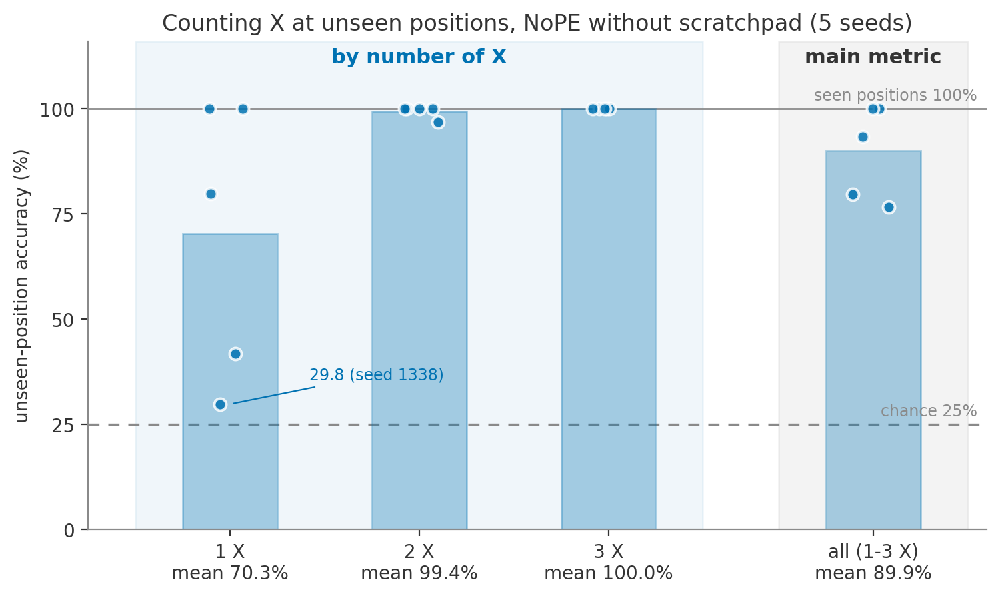
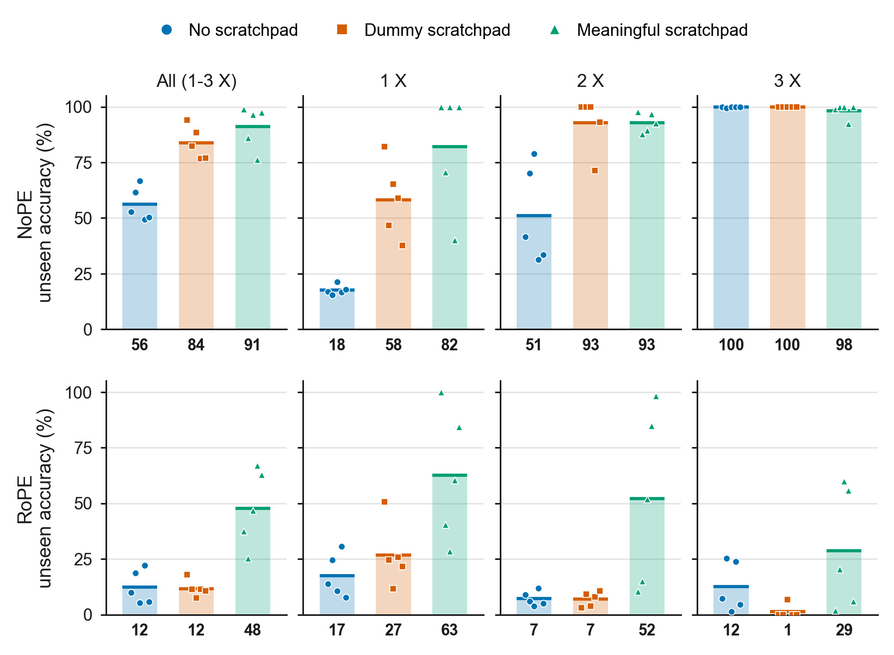
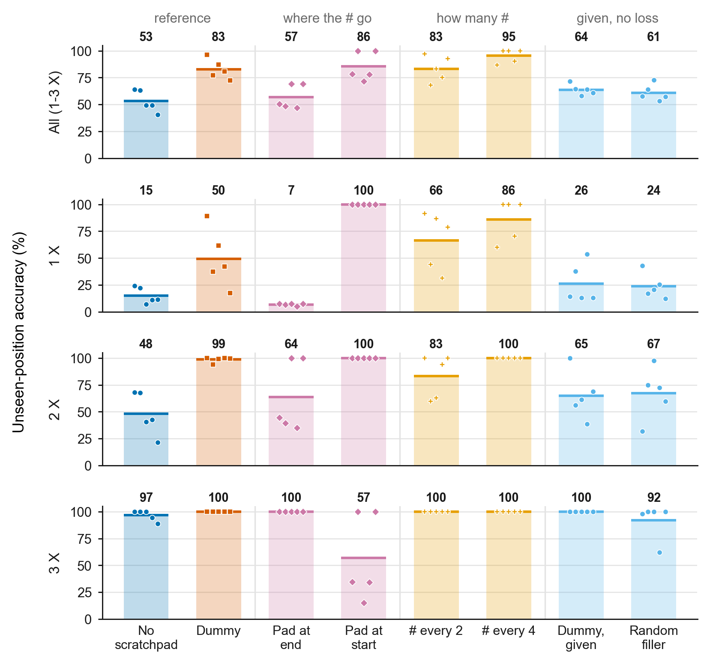
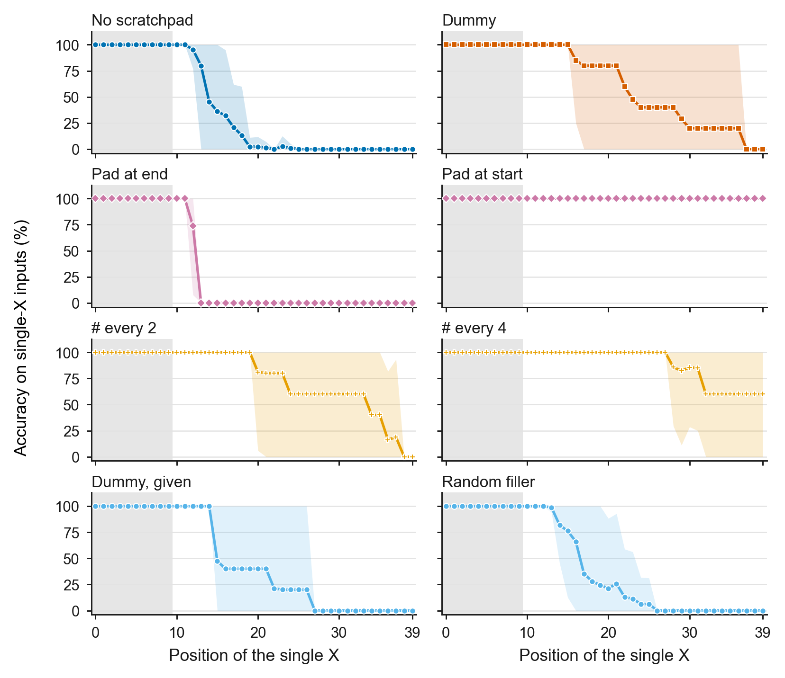

# Counting Task with Scratchpad Tokens: Experiment Plan

**Status:** Steps 1-5 done (logs below). Step 2 chose setting B (length 40, `X` seen in
positions 0-9, tested on 10-39); Steps 3 (NoPE) and 4 (RoPE) ran on it, and Step 5
tested why the dummy scratchpad helps with NoPE  
**Date:** October 6, 2026 (updated October 30, 2026)

## Summary

The model reads a 20-character string and answers **how many `X`s it contains**
(0 to 3). During training, `X`s appear only in the first half of the string. At test
time, they appear only in the second half, at positions the model has never seen an
`X` in.

We first check whether a plain model (no scratchpad) can already do this. If it
fails, we test whether a **scratchpad**, where the model writes a running count as it
reads, helps it succeed. The experiment is run with NoPE first, then repeated with RoPE.

This follows the distance experiment, where the scratchpad raised accuracy on unseen
positions to 100% ([results](../generalization-distd-scratchpad/README.md)).

The plain model already did well at length 20 (Step 1), so Steps 3 and 4 use the
meeting note's harder variant: a 40-character string with `X`s only in positions 0-9
during training and only in 10-39 at test (setting B, Step 2).

## Results so far

### Step 1: NoPE without a scratchpad



All five seeds were 100% on seen positions. On unseen positions, the mean was 89.9%
for counts 1-3: two seeds were perfect, and almost every error answered 0 when the
unseen half had a single `X`. Details: [Step 1 log](log/2026-10-06-step1-nope-baseline.md).

### Step 2: Making the task harder

- Setting A (length 40, `X` seen in 0-19, tested on 20-39): 94.7% on unseen positions,
  too easy. [Step 2A log](log/2026-10-12-step2a-length40-half-split.md)
- Setting B (length 40, `X` seen in 0-9, tested on 10-39): 56.2%, below the pre-set bar
  of 70%; every seed stops seeing a lone `X` near position 16. Used for Steps 3-4.
  [Step 2B log](log/2026-10-12-step2b-length40-small-train-region.md)

### Steps 3 and 4: Scratchpad comparison (setting B)



| | No scratchpad | Dummy | Meaningful |
|---|---:|---:|---:|
| NoPE (Step 3) | 56.2% | 83.7% | 91.1% |
| RoPE (Step 4) | 12.4% | 11.7% | 47.9% |

- **NoPE:** the meaningful scratchpad is best, and three of five seeds count a lone `X`
  at every unseen position. The dummy scratchpad also helps a lot; Step 5 tests why.
  Remaining errors: the model writes the `+1`, then drops the count.
  [Step 3 log](log/2026-10-12-step3-nope-scratchpad.md)
- **RoPE:** fails without a scratchpad (12.4%); the dummy does not help; the meaningful
  scratchpad helps in every seed but stays far from 100%, mostly because the model
  does not add 1 at an unseen `X`. [Step 4 log](log/2026-10-13-step4-rope-scratchpad.md)

### Step 5: Why the dummy helps (NoPE, setting B)



*Unseen-position accuracy at 2,000 iterations. Bar and line: mean over five seeds (the
number above each bar); dots: seeds. Versions are grouped by what they test.*

| Version | Unseen, counts 1-3 | k=1 | k=2 | k=3 | vs no scratchpad |
|---|---:|---:|---:|---:|---|
| No scratchpad (rerun) | 53.33 +/- 10.15% | 15.2% | 48.2% | 96.6% | — |
| Dummy (rerun) | 82.68 +/- 9.31% | 49.5% | 98.5% | 100% | above (5/5) |
| Pad at end | 56.91 +/- 11.31% | 6.9% | 63.8% | 100% | about equal (2/5) |
| Pad at start | 85.59 +/- 13.42% | 100% | 100% | 56.8% | above (5/5) |
| `#` every 2 | 83.25 +/- 12.10% | 66.4% | 83.3% | 100% | above (5/5) |
| `#` every 4 | 95.37 +/- 6.46% | 86.1% | 100% | 100% | above (5/5) |
| Random filler (given) | 61.03 +/- 7.56% | 23.7% | 67.3% | 92.0% | above (4/5) |
| Dummy, given | 63.81 +/- 5.03% | 26.4% | 65.0% | 100% | above (5/5) |

- The extra tokens alone do not explain the gain: every comparison fixed before running
  came out against it. Pad at end (41 `#` after the input) does not help, pad at start
  (41 `#` that cannot see the input) does, `#` every 4 beats every 2, and the random
  filler is below dummy given.
- Writing the `#` matters: the dummy beats dummy given in all 5 seeds.
- Pad at start counts a lone `X` at every unseen position in every seed, but in 3 of
  5 seeds it answers 2 on many count-3 inputs.
- Not separated yet: every version that beats no scratchpad both moves the input
  letters away from positions 0-39 and starts with a token that is not an input letter.
  Pad at end does neither.

Details: [Step 5](#step-5-why-does-the-dummy-scratchpad-help-nope).

## The task

```text
position:   0000000000 1111111111
            0123456789 0123456789
            ---------- ----------
training:   mpXaXdqXrb kzuwhnfeoc :3    X only in positions 0-9
test:       kzuwhnfeoc mpXaXdqXrb :3    X only in positions 10-19
```

*(The space between the halves is only for readability.)*

- Every input is exactly **20 characters**. Only the position of the `X`s changes
  between training and test, not the length.
- The other characters are random lowercase letters. Digits are not used as filler
  because digits are now the answers.
- The answer is **0, 1, 2, or 3**, each 25% of the data.

## Three versions of the model

All three use the same model, the same data, and the same seeds. The only difference
is what the model writes before the answer. The model uses NoPE (no positional
encoding) first, and RoPE in Step 4.

| Version | What the model writes | Example |
|---|---|---|
| **No scratchpad** | Only the answer | `mpXaXdqXrbkzuwhnfeoc:3` |
| **Dummy scratchpad** | A meaningless `#` after every character | `#m#p#X#a#X#d#q#X#r#b#k#…#:3` |
| **Meaningful scratchpad** | The number of `X`s seen so far | `0m0p0X1a1X2d2q2X3r3b3k3…3:3` |

How the meaningful scratchpad works:

```text
input:    m  p  X  a  X  d  q  X  r  b  ...
count:  0  0  0  1  1  2  2  2  3  3  3 ...   (+1 at every X)
```

The dummy version makes the sequence the same length as the meaningful one. If only
the meaningful version succeeds, the benefit comes from the counts themselves, not
from the longer sequence.

## Plan

### Step 1: Can the plain model already do it?

Train the **no-scratchpad** version only, with 5 seeds.

- **It fails on the test positions** → there is room for the scratchpad to help. Go to
  Step 3.
- **It gets about 100%** → the task is too easy here. Go to Step 2.

We expect it might be too easy. Counting does not care *where* the `X`s are, just like
the detection task in Phase 1, which the model solved easily.

### Step 2 (only if too easy): Make it harder

As suggested in the meeting note, use a longer input and/or show `X`s in a smaller
part of it during training:

| Setting | Input length | Training `X` positions | Test `X` positions |
|---|---:|---|---|
| A | 40 | 0-19 | 20-39 |
| B | 40 | 0-9 | 10-39 |
| C | 80 | to decide | to decide |

Try them in order and stop at the first one where the plain model fails.

"Fails" was fixed before running: every seed 100% on seen positions, mean unseen
accuracy (counts 1-3) at most about 70%, and at most one perfect seed.

**Result (October 12, 2026; NoPE, no scratchpad, 5 seeds):**

| Setting | Seen positions | Unseen, counts 1-3 | k=1 | k=2 | k=3 | Decision |
|---|---:|---:|---:|---:|---:|---|
| A | 100% | 94.69 +/- 4.61% | 84.1% | 100% | 100% | too easy |
| B | 100% | 56.19 +/- 7.64% | 17.6% | 51.1% | 99.9% | **chosen** |

In B, every seed misses a lone `X` from about position 16 onward. C was not needed.

### Step 3: Full comparison

Train all three versions × 5 seeds on setting B and compare their accuracy on the
test positions.

Metrics, fixed before running Step 3:

- **Main result:** unseen-position accuracy on counts 1-3 (as planned).
- Reported next to it: counts 1 and 2 separately, because count 3 is near 100% even
  without a scratchpad and lifts the average.
- Count-1 accuracy by `X` position, to see whether the miss after about position 16
  disappears.
- Scratchpads: accuracy of the counts the model writes itself (all steps, and the step
  right after each `X`).
- Scratchpad sequences are 82 tokens, so Steps 3-4 use `block_size = 96`. NoPE and
  RoPE have no parameters that depend on it.

### Step 4: Repeat with RoPE

Run the same experiment with RoPE instead of NoPE, on the same setting, as was done for
the distance task. This also answers the meeting note's question of whether RoPE
reaches 100% on unseen positions without a scratchpad.

### Step 5: Why does the dummy scratchpad help? (NoPE)

From the October 16 meeting. The dummy scratchpad (`#` after every input character)
was meant as a control, but with NoPE it raised count-1 accuracy from 17.6% to 58.1%
and count-2 accuracy from 51.1% to 92.9%, as high as the meaningful scratchpad on
count 2.

- **Question:** why does a scratchpad that carries no information help?
- **Hypothesis:** the dummy doubles the number of tokens. More tokens may give the
  model more room to compute and store intermediate results, with the same number of
  parameters.

**What the dummy changes.** Count-1 accuracy by `X` position (Step 3, 2,000
iterations, 5 seeds pooled, from `predictions_step3_nope.csv`):

| `X` position | 10-14 | 15-19 | 20-24 | 25-29 | 30-34 | 35-39 |
|---|---:|---:|---:|---:|---:|---:|
| No scratchpad | 99% | 25% | 0% | 0% | 0% | 0% |
| Dummy | 100% | 100% | 87% | 54% | 22% | 0% |
| Meaningful | 100% | 100% | 91% | 80% | 67% | 60% |

The dummy does not remove the drop; it moves it later. Without a scratchpad, every
seed loses a lone `X` from about position 16 (Step 2B). With the dummy, the first
5-position range under 50% is 20-24 (seed 1341), 25-29 (1338), 30-34 (1339, 1340), or
35-39 (1337). Every dummy seed is 0% at 35-39, right before `:`, even seed 1337, which
is 100% up to position 34. Every wrong answer on a lone `X` is 0, in all three
versions.

**Versions.** The meeting suggested three tests: random scratchpad tokens (idea 1),
fewer `#` slots (idea 2), and moving the `#` slots (idea 3). All versions use setting
B, the same input strings, model seeds 1337-1341, and the Step 3 model and training.
As in Step 3, the model writes every `#` itself: each `#` is a target in training, and
at test time the model writes it (free-running). Only the first token of a sequence is
given, since nothing comes before it.

| Version | Example | Meeting idea | `#` written by the model |
|---|---|---|---:|
| No scratchpad (rerun) | `mpXaXdqXrb…:3` | reference | 0 |
| Dummy (rerun, as in Step 3) | `#m#p#X#a#X…#:3` | reference | 40 (+1 given) |
| Pad at end | `mpXaXdqXrb…###…###:3` | 3 | 41 |
| Pad at start | `###…###mpXaXdqXrb…:3` | 3 | 40 (+1 given) |
| `#` every 2 | `#mp#Xa#Xd#qX#rb#…#:3` | 2 | 20 (+1 given) |
| `#` every 4 | `#mpXa#XdqX#rbkz#…#:3` | 2 | 10 (+1 given) |
| Random filler | `!m%p+X&a?X…<:3` | 1 | 0 (41 given, no loss) |
| Dummy, given (reference for random) | `#m#p#X#a#X…#:3` | — | 0 (41 given, no loss) |

**First batch (stopped).** The first version of this plan gave every filler token to
the model and put no loss on it. That is not how the scratchpad works in Steps 3-4 and
the distance experiment, where the model writes every state and is trained on it, so
the batch was stopped on October 30 after 14 runs. All were 100% on seen positions:

| Version (fillers given, no loss) | Seeds | Unseen, counts 1-3 | k=1 | k=2 |
|---|---:|---:|---:|---:|
| No scratchpad | 5 | 53.33 +/- 10.15% | 15.2% | 48.2% |
| Dummy, given | 5 | 63.81 +/- 5.03% | 26.4% | 65.0% |
| Pad at end, given | 4 | 62.78 +/- 25.25% | 32.3% | 57.0% |

The given dummy beats no scratchpad in all 5 seeds but stays far below the Step 3
dummy (83.67%). Pad at end, given, is 44.5%, 50.7%, 56.0%, and 100% by seed. The no
scratchpad reruns stay the reference (they have no fillers, so nothing changes), and
dummy given becomes the reference for the random filler. Files:
`results_step5_nope.csv`, `predictions_step5_nope.csv` (pad at end, given, is
`pad_end_given`).

**Design choices.**

- **The model writes every `#`, as in Step 3.** The `#` slots are state targets with
  the same loss as in Step 3, and at test time the model writes them itself. The first
  token of a sequence is given (the dummy's leading `#`, and the first `#` of pad at
  start), because nothing comes before it.
- **Random symbols are the one exception.** The model cannot predict a random symbol,
  so it could not write one at test time. The random filler is given in training and
  at test time with no loss on it, and it is compared with dummy given, which follows
  the same rule.
- **One vocabulary for every Step 5 version:** the 33 tokens of Steps 3-4 plus 10 new
  symbols (`!$%&*+<=>?`) for the random filler. This keeps the parameter count the
  same across versions, as in Steps 3-4. The larger embedding changes the starting
  weights, so no scratchpad and the dummy are rerun inside Step 5, and every Step 5
  comparison is paired by seed within Step 5. The no scratchpad rerun is 53.3% (Step
  3: 56.2%); the dummy rerun should land near 83.7%, and a large gap is reported
  before anything else.
- **Same input strings as Step 3.** The token ids change with the new vocabulary, so
  the data files are rebuilt with data seed 1337 and checked against the Step 3
  strings.
- **Random symbols are new symbols, not letters or digits.** NoPE has no position
  signal to tell an input letter from a filler letter, and digits are the counts and
  answers. A symbol is drawn for every slot of every example with the data seed, so
  every run sees the same symbols.
- **The pad versions use 41 `#`, the same as the dummy.** The sequence stays 82 tokens
  (`block_size = 96`), and only the place of the `#`s changes.
- **Every 2 and every 4, not every 3:** 40 divides evenly, and the number of `#`
  halves each time (41, 21, 11).
- **NoPE only.** With RoPE the dummy did not help (12.4% vs 11.7%), so the effect is
  explained with NoPE first.

**Predictions, fixed before running.** The meeting guessed that random tokens and
fewer slots would still beat no scratchpad, and left the placement test open (it could
help or not). The table below is what the hypothesis implies, not a guess from the
meeting. Main metric as in Step 3 (unseen positions, counts 1-3). "Above" means higher
in at least 4 of 5 seeds, paired by seed; "about equal" means neither is higher in 4 of
5 seeds. The references are the Step 5 reruns (dummy given for the random filler).

| Version | If the extra tokens add computation | Against it |
|---|---|---|
| Pad at start | about equal to no scratchpad: these `#`s come before the input and cannot see it | above no scratchpad |
| Pad at end | above no scratchpad | about equal to no scratchpad |
| `#` every 2, every 4 | between no scratchpad and the dummy; more `#` is better | no order by number of `#` |
| Random filler | about equal to dummy given | below dummy given (weak test, see below) |

How to read them:

- **Pad at start vs pad at end is the main test.** Both add the same 41 tokens; only
  the `#`s at the end can see the input. If pad at start also helps, the gain is not
  (only) extra computation: moving the input later may change how a NoPE model tells
  positions apart.
- **Pad at end also puts 41 tokens between the input and `:`**, so it shows whether
  the 0% at positions 35-39 comes from the `X` being right before `:`.
- **Random filler is the weakest test.** If it is below dummy given, the cause could be
  that the token itself matters, or that the model has to learn to ignore random
  symbols. It is run because it is cheap, not to decide the hypothesis.
- **Dummy rerun vs Step 3.** If the dummy rerun is near 83.7%, the new vocabulary does
  not matter, and the gap to dummy given (63.8%) comes from writing the `#`.

Metrics, fixed before running:

- **Main result:** unseen-position accuracy on counts 1-3, with counts 1 and 2
  separately.
- **Count-1 accuracy by `X` position, per seed,** and the first 5-position range under
  50%. This is where the dummy differs from no scratchpad, so it is the main figure
  for this step.
- For the versions that write `#`: how often the written `#` is right, as in Step 3.

Cost: 6 versions × 5 seeds = 30 runs (no scratchpad and dummy given are done). At the
current machine load an 82-token run takes about 14 minutes to train, plus
free-running evaluation, so about 7-9 hours in sequence. (They finished on October 30
in about 5 hours.)

Code changes (done): `--random_symbols` in `data/count_scratchpad/prepare.py` and the
rebuilt data folder `data/count_scratchpad_L40_seen10_step5` (checked: the same
strings and labels as Step 3); the new versions in `scratchpad.py` (the `#` versions
write their slots as state targets; random filler and dummy given are given); the
random symbols drawn in `dataset.py`; `evaluate.py` running free-running evaluation
for every `#` layout and one forward pass for the given versions; format and mask
tests in `test_scratchpad.py`.

Run:

```bash
../venv/bin/python data/count_scratchpad/prepare.py --length=40 --seen_end=10 \
  --random_symbols='!$%&*+<=>?' --out_dir=data/count_scratchpad_L40_seen10_step5
DATA_DIR=data/count_scratchpad_L40_seen10_step5 BLOCK_SIZE=96 POS_TYPE=none \
  CONDITIONS="dummy pad_end pad_start every2 every4 random_filler" \
  RUN_PREFIX=out_step5_nope RESULTS_CSV=results_step5b_nope.csv \
  PREDICTIONS_CSV=predictions_step5b_nope.csv ./run_multiseed.sh
```

**Result (October 30, 2026; NoPE, setting B, 5 seeds).** All runs were 100% on seen
positions, and the versions that write `#` wrote it correctly at least 99.97% of the
time on unseen positions, in every run. The dummy rerun is 82.68%, close to Step 3 (83.67%), so the
new vocabulary does not matter. Files: `results_step5b_nope.csv`,
`predictions_step5b_nope.csv` (no scratchpad and dummy given are in the first-batch
files).

Against the predictions (unseen positions, counts 1-3, paired by seed):

| Version | Result | Side |
|---|---|---|
| Pad at start | above no scratchpad (higher in 5/5) | against it |
| Pad at end | about equal to no scratchpad (higher in 2/5, lower in 3/5) | against it |
| `#` every 2, every 4 | every 4 above every 2 (higher in 4/5): fewer `#` was better | against it |
| Random filler | below dummy given (lower in 4/5) | against it (weak test) |

Other paired comparisons: every `#` version except pad at end is above no scratchpad
(5/5). Against the dummy, every 4 is above (4/5), pad at start and every 2 are about
equal (2/5 each), and pad at end is below (5/5). The dummy is above dummy given (5/5),
and dummy given and the random filler are both above no scratchpad (5/5 and 4/5).

Per seed, counts 1-3:

| Version | 1337 | 1338 | 1339 | 1340 | 1341 |
|---|---:|---:|---:|---:|---:|
| No scratchpad | 64.20 | 63.33 | 49.20 | 49.27 | 40.67 |
| Dummy | 96.33 | 77.13 | 86.93 | 80.67 | 72.33 |
| Pad at end | 50.67 | 48.67 | 69.20 | 46.80 | 69.20 |
| Pad at start | 78.20 | 100.00 | 71.67 | 78.07 | 100.00 |
| `#` every 2 | 97.13 | 67.93 | 83.20 | 75.13 | 92.87 |
| `#` every 4 | 86.67 | 100.00 | 100.00 | 90.20 | 100.00 |
| Random filler | 57.53 | 64.00 | 72.73 | 53.47 | 57.40 |
| Dummy, given | 71.47 | 64.60 | 58.13 | 64.13 | 60.73 |



*Accuracy on inputs with a single `X`, by the `X`'s position. Line: mean over five
seeds; band: range across seeds; gray: positions seen in training (0-9). The versions
being compared sit side by side.*

Count-1 accuracy by `X` position (5 seeds pooled), and the first 5-position range
under 50% in each seed (1337-1341):

| Version | 10-14 | 15-19 | 20-24 | 25-29 | 30-34 | 35-39 | First range under 50% |
|---|---:|---:|---:|---:|---:|---:|---|
| No scratchpad | 85% | 21% | 1% | 0% | 0% | 0% | 20, 20, 15, 15, 15 |
| Dummy | 100% | 85% | 60% | 38% | 20% | 8% | 35, 20, 30, 25, 15 |
| Pad at end | 52% | 0% | 0% | 0% | 0% | 0% | 15, 15, 15, 10, 15 |
| Pad at start | 100% | 100% | 100% | 100% | 100% | 100% | none in any seed |
| `#` every 2 | 100% | 100% | 76% | 60% | 56% | 16% | none, 25, 35, 20, 35 |
| `#` every 4 | 100% | 100% | 100% | 93% | 69% | 60% | 30, none, none, 30, none |
| Random filler | 97% | 46% | 15% | 1% | 0% | 0% | 25, 15, 15, 20, 15 |
| Dummy, given | 100% | 41% | 28% | 8% | 0% | 0% | 15, 20, 15, 25, 15 |

(A range is named by its first position: 20 means 20-24.) As in Step 3, every wrong
answer on a lone `X` is 0, in every version.

What the result shows:

- **The extra tokens alone do not explain the gain.** All four predictions came out on
  the "against it" side. By the reading fixed before running, pad at start helping
  means the gain is not (only) extra computation.
- **Pad at end does not help.** Count 1 drops to 6.9% (no scratchpad: 15.2%), and a
  lone `X` is 0% from 15-19 on. It is still 0% at 35-39 with 41 `#` before `:`, but
  pad at end fails long before that, so it does not tell whether the dummy's drop at
  35-39 comes from the `:`.
- **Pad at start fails in a different way.** Counts 1 and 2 are 100% in every seed and
  at every position, but count 3 is 34.6%, 15.0%, and 34.2% in seeds 1337, 1339, and
  1340 (100% in 1338 and 1341). Every wrong count-3 answer is 2, and it gets worse the
  later the last `X` is (last `X` in 20-24: 94%; 25-29: 71%; 30-34: 52%; 35-39: 42%).
- **`#` every 4 is the best version** (95.37%, three perfect seeds) and the only one
  above the dummy.
- **The random filler is the only version that answers above the true count** (189
  count-2 inputs answered 3).
- **Writing the `#` matters.** The dummy is above dummy given in all 5 seeds (82.68%
  vs 63.81%). At test time both see the same sequence (the written `#` are right), so
  the difference comes from training on the `#` targets.

Not separated by this experiment: every version that beats no scratchpad changes two
things at once. The input letters move away from positions 0-39, and the sequence
starts with a token that is not an input letter (`#`, or a random symbol). Pad at end
changes neither: its input letters sit at 0-39, as without a scratchpad, and its first
token is an input letter. So pad at start and pad at end differ in both, and either
could be the cause. A check that separates them (not run): no scratchpad with one
leading `#` (42 tokens, 5 seeds), which adds the leading token but moves the input by
only one position.

Each step ends with a report before the next one starts.

## How to read the results

| What we see | What it means |
|---|---|
| No scratchpad already gets about 100% | Too easy; we cannot measure a scratchpad effect |
| Meaningful beats both dummy and no scratchpad | Writing the running count helps the model generalize |
| Meaningful and dummy are similar, both beat no scratchpad | The longer sequence, not the counts, may be what helps |
| Every version fails even on training positions | Training is broken; fix it before reading the test results |

## Details

### Where the design comes from

| From the October 2 meeting note | Chosen to match earlier experiments |
|---|---|
| Counting task, filler letters | Input length 20 |
| Count range "0-9 or 0-3" | Train on positions 0-9, test on 10-19 |
| Scratchpad format `0m0p0X1…:4` | NoPE first, then RoPE |
| Longer inputs (40, 80) if too easy | Dummy scratchpad as a control |

### Special cases

- **Count 0:** an input with no `X` has no `X` position, so it is the same in training
  and test. It is kept in the data, but the main test score uses counts 1-3 only, and
  count 0 is reported separately.
- **Dummy token:** `#` replaces the `z` used in the distance experiment, because `z` is
  now a filler letter.
- **Starting `0` (or `#`):** always the same, so it is given to the model rather than
  predicted.

### Model and training

Same as the distance scratchpad experiment:

- 4 layers, 4 heads, embedding size 128, about 0.8M parameters.
- 2,000 training iterations; checkpoints at 500, 1,000, 1,500, and 2,000.
- 50,000 training, 5,000 validation, and 2,000 test examples.
- Model seeds 1337-1341; data seed 1337.
- Loss only on what the model must write (counts or `#`, and the answer), not on the
  input characters.
- At test time, the model writes each count itself and keeps it in the context, the
  same way it is used in practice.

### What we measure

- **Main result:** accuracy on test positions, counts 1-3.
- Accuracy for each count (0, 1, 2, 3).
- Which wrong answers appear (e.g. does the model miss `X`s in the unseen half?).
- For scratchpads: how often each written count is correct, especially right after
  an `X`.

### Files (planned)

```text
generalization-count-scratchpad/
├── README.md
├── engine.py              # reuses the verified model from generalization-distd
├── scratchpad.py          # running-count states
├── dataset.py
├── train.py
├── evaluate.py            # accuracy per count, wrong-answer table
├── test_scratchpad.py
├── run_multiseed.sh
├── config/basic.py
├── data/count_scratchpad/prepare.py   # length, training region, count range
└── log/
```

Most files are adapted from `generalization-distd-scratchpad/`.
