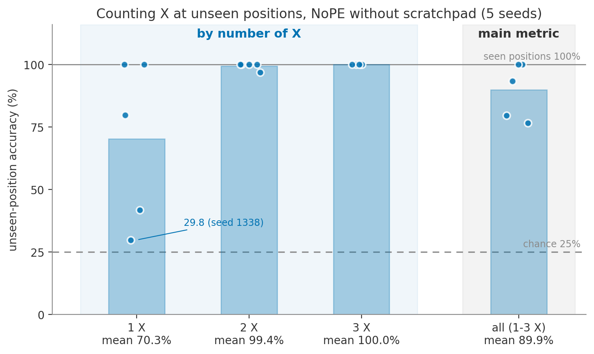
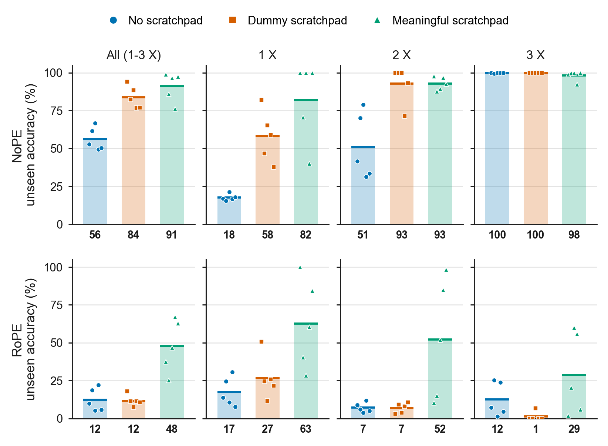

# Counting Task with Scratchpad Tokens: Experiment Plan

**Status:** Steps 1-4 done (logs below). Step 2 chose setting B (length 40, `X` seen in
positions 0-9, tested on 10-39); Steps 3 (NoPE) and 4 (RoPE) ran on it  
**Date:** October 6, 2026 (updated October 13, 2026)

## Summary

The model reads a 20-character string and answers **how many `X`s it contains**
(0 to 3). During training, `X`s appear only in the first half of the string. At test
time, they appear only in the second half, at positions the model has never seen an
`X` in.

We first check whether a plain model (no scratchpad) can already do this. If it
fails, we test whether a **scratchpad**, where the model writes a running count as it
reads, helps it succeed. The experiment is run with NoPE first, then repeated with RoPE.

This follows the distance experiment, where the scratchpad raised accuracy on unseen
positions to 100% ([results](../generalization-distd-scratchpad/README.md)).

The plain model already did well at length 20 (Step 1), so Steps 3 and 4 use the
meeting note's harder variant: a 40-character string with `X`s only in positions 0-9
during training and only in 10-39 at test (setting B, Step 2).

## Results so far

### Step 1: NoPE without a scratchpad



All five seeds were 100% on seen positions. On unseen positions, the mean was 89.9%
for counts 1-3: two seeds were perfect, and almost every error answered 0 when the
unseen half had a single `X`. Details: [Step 1 log](log/2026-10-06-step1-nope-baseline.md).

### Step 2: Making the task harder

- Setting A (length 40, `X` seen in 0-19, tested on 20-39): 94.7% on unseen positions,
  too easy. [Step 2A log](log/2026-10-12-step2a-length40-half-split.md)
- Setting B (length 40, `X` seen in 0-9, tested on 10-39): 56.2%, below the pre-set bar
  of 70%; every seed stops seeing a lone `X` near position 16. Used for Steps 3-4.
  [Step 2B log](log/2026-10-12-step2b-length40-small-train-region.md)

### Steps 3 and 4: Scratchpad comparison (setting B)



| | No scratchpad | Dummy | Meaningful |
|---|---:|---:|---:|
| NoPE (Step 3) | 56.2% | 83.7% | 91.1% |
| RoPE (Step 4) | 12.4% | 11.7% | 47.9% |

- **NoPE:** the meaningful scratchpad is best, and three of five seeds count a lone `X`
  at every unseen position. The dummy scratchpad also helps a lot, which is not
  explained yet. Remaining errors: the model writes the `+1`, then drops the count.
  [Step 3 log](log/2026-10-12-step3-nope-scratchpad.md)
- **RoPE:** fails without a scratchpad (12.4%); the dummy does not help; the meaningful
  scratchpad helps in every seed but stays far from 100%, mostly because the model
  does not add 1 at an unseen `X`. [Step 4 log](log/2026-10-13-step4-rope-scratchpad.md)

## The task

```text
position:   0000000000 1111111111
            0123456789 0123456789
            ---------- ----------
training:   mpXaXdqXrb kzuwhnfeoc :3    X only in positions 0-9
test:       kzuwhnfeoc mpXaXdqXrb :3    X only in positions 10-19
```

*(The space between the halves is only for readability.)*

- Every input is exactly **20 characters**. Only the position of the `X`s changes
  between training and test, not the length.
- The other characters are random lowercase letters. Digits are not used as filler
  because digits are now the answers.
- The answer is **0, 1, 2, or 3**, each 25% of the data.

## Three versions of the model

All three use the same model, the same data, and the same seeds. The only difference
is what the model writes before the answer. The model uses NoPE (no positional
encoding) first, and RoPE in Step 4.

| Version | What the model writes | Example |
|---|---|---|
| **No scratchpad** | Only the answer | `mpXaXdqXrbkzuwhnfeoc:3` |
| **Dummy scratchpad** | A meaningless `#` after every character | `#m#p#X#a#X#d#q#X#r#b#k#…#:3` |
| **Meaningful scratchpad** | The number of `X`s seen so far | `0m0p0X1a1X2d2q2X3r3b3k3…3:3` |

How the meaningful scratchpad works:

```text
input:    m  p  X  a  X  d  q  X  r  b  ...
count:  0  0  0  1  1  2  2  2  3  3  3 ...   (+1 at every X)
```

The dummy version makes the sequence the same length as the meaningful one. If only
the meaningful version succeeds, the benefit comes from the counts themselves, not
from the longer sequence.

## Plan

### Step 1: Can the plain model already do it?

Train the **no-scratchpad** version only, with 5 seeds.

- **It fails on the test positions** → there is room for the scratchpad to help. Go to
  Step 3.
- **It gets about 100%** → the task is too easy here. Go to Step 2.

We expect it might be too easy. Counting does not care *where* the `X`s are, just like
the detection task in Phase 1, which the model solved easily.

### Step 2 (only if too easy): Make it harder

As suggested in the meeting note, use a longer input and/or show `X`s in a smaller
part of it during training:

| Setting | Input length | Training `X` positions | Test `X` positions |
|---|---:|---|---|
| A | 40 | 0-19 | 20-39 |
| B | 40 | 0-9 | 10-39 |
| C | 80 | to decide | to decide |

Try them in order and stop at the first one where the plain model fails.

"Fails" was fixed before running: every seed 100% on seen positions, mean unseen
accuracy (counts 1-3) at most about 70%, and at most one perfect seed.

**Result (October 12, 2026; NoPE, no scratchpad, 5 seeds):**

| Setting | Seen positions | Unseen, counts 1-3 | k=1 | k=2 | k=3 | Decision |
|---|---:|---:|---:|---:|---:|---|
| A | 100% | 94.69 +/- 4.61% | 84.1% | 100% | 100% | too easy |
| B | 100% | 56.19 +/- 7.64% | 17.6% | 51.1% | 99.9% | **chosen** |

In B, every seed misses a lone `X` from about position 16 onward. C was not needed.

### Step 3: Full comparison

Train all three versions × 5 seeds on setting B and compare their accuracy on the
test positions.

Metrics, fixed before running Step 3:

- **Main result:** unseen-position accuracy on counts 1-3 (as planned).
- Reported next to it: counts 1 and 2 separately, because count 3 is near 100% even
  without a scratchpad and lifts the average.
- Count-1 accuracy by `X` position, to see whether the miss after about position 16
  disappears.
- Scratchpads: accuracy of the counts the model writes itself (all steps, and the step
  right after each `X`).
- Scratchpad sequences are 82 tokens, so Steps 3-4 use `block_size = 96`. NoPE and
  RoPE have no parameters that depend on it.

### Step 4: Repeat with RoPE

Run the same experiment with RoPE instead of NoPE, on the same setting, as was done for
the distance task. This also answers the meeting note's question of whether RoPE
reaches 100% on unseen positions without a scratchpad.

Each step ends with a report before the next one starts.

## How to read the results

| What we see | What it means |
|---|---|
| No scratchpad already gets about 100% | Too easy; we cannot measure a scratchpad effect |
| Meaningful beats both dummy and no scratchpad | Writing the running count helps the model generalize |
| Meaningful and dummy are similar, both beat no scratchpad | The longer sequence, not the counts, may be what helps |
| Every version fails even on training positions | Training is broken; fix it before reading the test results |

## Details

### Where the design comes from

| From the October 2 meeting note | Chosen to match earlier experiments |
|---|---|
| Counting task, filler letters | Input length 20 |
| Count range "0-9 or 0-3" | Train on positions 0-9, test on 10-19 |
| Scratchpad format `0m0p0X1…:4` | NoPE first, then RoPE |
| Longer inputs (40, 80) if too easy | Dummy scratchpad as a control |

### Special cases

- **Count 0:** an input with no `X` has no `X` position, so it is the same in training
  and test. It is kept in the data, but the main test score uses counts 1-3 only, and
  count 0 is reported separately.
- **Dummy token:** `#` replaces the `z` used in the distance experiment, because `z` is
  now a filler letter.
- **Starting `0` (or `#`):** always the same, so it is given to the model rather than
  predicted.

### Model and training

Same as the distance scratchpad experiment:

- 4 layers, 4 heads, embedding size 128, about 0.8M parameters.
- 2,000 training iterations; checkpoints at 500, 1,000, 1,500, and 2,000.
- 50,000 training, 5,000 validation, and 2,000 test examples.
- Model seeds 1337-1341; data seed 1337.
- Loss only on what the model must write (counts or `#`, and the answer), not on the
  input characters.
- At test time, the model writes each count itself and keeps it in the context, the
  same way it is used in practice.

### What we measure

- **Main result:** accuracy on test positions, counts 1-3.
- Accuracy for each count (0, 1, 2, 3).
- Which wrong answers appear (e.g. does the model miss `X`s in the unseen half?).
- For scratchpads: how often each written count is correct, especially right after
  an `X`.

### Files (planned)

```text
generalization-count-scratchpad/
├── README.md
├── engine.py              # reuses the verified model from generalization-distd
├── scratchpad.py          # running-count states
├── dataset.py
├── train.py
├── evaluate.py            # accuracy per count, wrong-answer table
├── test_scratchpad.py
├── run_multiseed.sh
├── config/basic.py
├── data/count_scratchpad/prepare.py   # length, training region, count range
└── log/
```

Most files are adapted from `generalization-distd-scratchpad/`.
