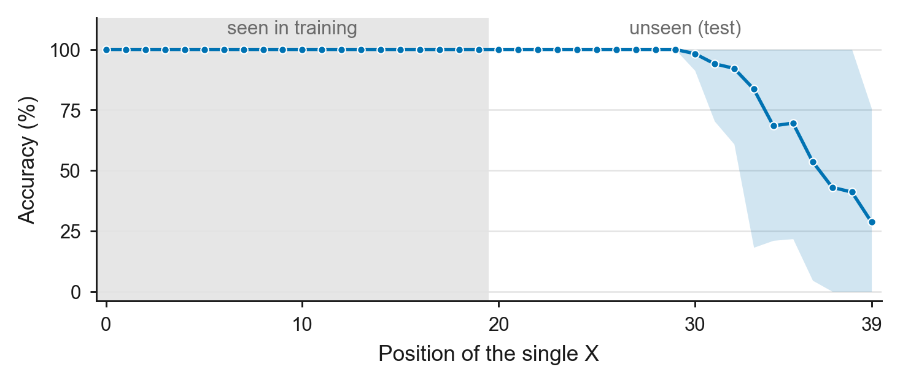

# Step 2A: Longer input, half split (length 40, train 0-19 / test 20-39)

**Date:** October 12, 2026
**Purpose:** Find a setting where the plain model (NoPE, no scratchpad) clearly fails at
unseen positions, so the scratchpad comparison has room to show an effect. This is the
first variant from the October 2 meeting note: a longer input with a half split.

## Activity summary

The length-20 baseline (Step 1) reached 89.9% on unseen positions, with two of five
seeds perfect. Following Prof. MacCormick's feedback that it is more interesting to
start from a task where the plain model does poorly, I tried the note's longer-input
variant before building the scratchpad comparison. At length 40 with a half split, every
seed was again 100% on seen positions, and the mean on unseen positions was **94.7%**
(counts 1-3), higher than at length 20. The errors had the same form as in Step 1: a
**single `X` answered as 0**. All seeds were perfect up to position 29; each seed then
started missing a lone `X` at its own position between 30 and 39. Inputs with two or
three `X`s were always correct. This setting is too easy, so I moved on to the note's
second split (Step 2B).

"Too easy" was fixed before running: the plain model must be 100% on seen positions for
every seed, at most about 70% on unseen positions (mean, counts 1-3), and perfect in at
most one seed.

## Experimental setup

- Task: output the number of `X`s (0-3) in a 40-character string of lowercase letters.
- Split: every `X` in positions 0-19 for training and validation; 20-39 for the test.
  Positions are numbered from 0.
- Data: 50,000 train, 5,000 validation, 2,000 test; 25% per count in every pool; data
  seed 1337.
- Model: NoPE, causal, 4 layers, 4 heads, embedding 128 (about 0.8M parameters); no
  scratchpad. Same as Step 1.
- Seeds 1337-1341; 2,000 iterations; checkpoints at 500 / 1,000 / 1,500 / 2,000.
- Main metric: unseen-position accuracy on counts 1-3 (count 0 has no `X` position and
  is reported separately).

Example data (real examples from the generated pools):

```text
position:  0         1         2         3
           0123456789012345678901234567890123456789
train:     jnhydmmhpvrXhsybytgoirhiclgcwwhswdzyrgia:1    X at 11
train:     lbmjcyikyldjqoXgXbmthoswdpwhybnmksqpjjhc:2    X at 14, 16
test:      bmavevrmoqkuljfyiolkaweeXklqyvazvhkreinb:1    X at 24
test:      hkwocygpllafrczgslopXpbXbqhvwgzjqymhyvbt:2    X at 20, 23
```

Commands:

```bash
../venv/bin/python data/count_scratchpad/prepare.py --length=40 --seen_end=20 --out_dir=data/count_scratchpad_L40_seen20
DATA_DIR=data/count_scratchpad_L40_seen20 RUN_PREFIX=out_step2A_nope RESULTS_CSV=results_step2A_nope.csv PREDICTIONS_CSV=predictions_step2A_nope.csv ./run_multiseed.sh
```

## Results



[Vector PDF](figures/step2a_position_accuracy.pdf)

*Figure 1. Accuracy on inputs with a single X, by the X's position (setting A: length
40, X seen in positions 0-19; NoPE, no scratchpad). Positions are numbered from 0
(0-39). Line: mean over five seeds; band: range across seeds. The gray region marks
positions seen in training. All seeds are perfect up to position 29. Beyond that, each
seed drops sharply at its own position (30-39) and answers 0, so the mean declines
gradually while the band spans 0-100%. Inputs with two or three X were answered
correctly by every seed at every position, so only single-X inputs are shown.*

Final checkpoint (2,000 iterations):

| Seed | Seen positions | Unseen, counts 1-3 | k=0 | k=1 | k=2 | k=3 |
|---|---:|---:|---:|---:|---:|---:|
| 1337 | 100% | 89.00% | 100% | 67.0% | 100% | 100% |
| 1338 | 100% | 99.20% | 100% | 97.6% | 100% | 100% |
| 1339 | 100% | 99.40% | 100% | 98.2% | 100% | 100% |
| 1340 | 100% | 94.33% | 100% | 83.0% | 100% | 100% |
| 1341 | 100% | 91.53% | 100% | 74.6% | 100% | 100% |
| **Mean +/- SD** | 100% | **94.69 +/- 4.61%** | 100% | 84.1% | 100% | 100% |

Every error was a single `X` answered as 0 (out of 500 single-X test inputs per seed):
165, 12, 9, 85, and 127 for seeds 1337-1341. No other error occurred.

Where each seed starts missing a lone `X` (first unseen position with an error, and the
first where accuracy falls below 50%):

| Seed | First error | Below 50% from |
|---|---:|---:|
| 1337 | 30 | 33 |
| 1338 | 39 | never (68% at 39) |
| 1339 | 39 | never (76% at 39) |
| 1340 | 36 | 37 |
| 1341 | 34 | 34 |

Comparison with length 20 (Step 1, same model and seeds):

| Setting | Length | Seen `X` positions | Unseen, counts 1-3 | k=1 | Perfect seeds |
|---|---:|---|---:|---:|---:|
| Step 1 | 20 | 0-9 | 89.88 +/- 11.18% | 70.3% | 2 of 5 |
| **Step 2A** | 40 | 0-19 | **94.69 +/- 4.61%** | 84.1% | 0 of 5 |

Mean unseen accuracy (counts 1-3) across checkpoints:

| 500 | 1,000 | 1,500 | 2,000 |
|---:|---:|---:|---:|
| 91.04% | 92.17% | 93.52% | 94.69% |

## Conclusion

**What worked:** Every seed learned the task (100% on seen positions) and transferred
to the first ten unseen positions (20-29) without a single error. Counts 2 and 3 were
perfect everywhere.

**What didn't work:** A lone `X` far from the training region (from position 30 to 39,
depending on the seed) was missed and answered 0.

**Decision:** Setting A is easier than length 20 (94.7% vs 89.9%), far above the
pre-set bar of about 70%, so it cannot show a scratchpad effect. One possible reason is
that the training region doubled from 10 to 20 positions while the split ratio stayed
50:50; this was not tested. Next: the note's second split, training on positions 0-9
only and testing on 10-39 (Step 2B).
