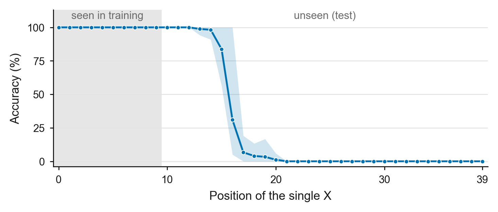
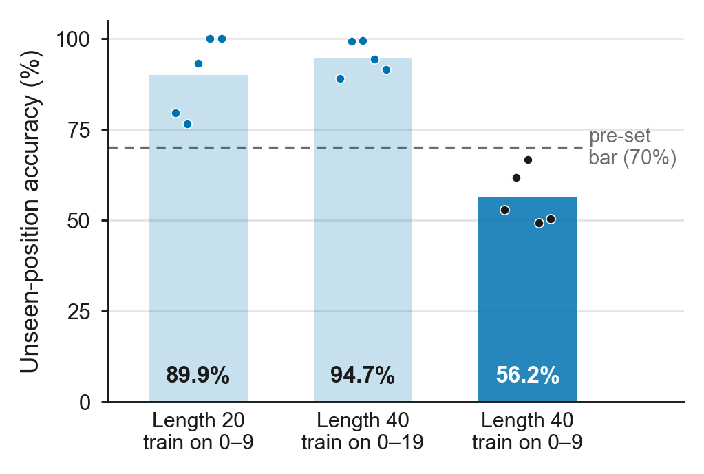

# Step 2B: Longer input, small training region (length 40, train 0-9 / test 10-39)

**Date:** October 12, 2026
**Purpose:** Second variant from the October 2 meeting note ("seen only 10; last 30
unseen"). Setting A (Step 2A) was too easy, so this keeps length 40 but shows `X`s in
only the first 10 positions during training. The goal is still a setting where the
plain model (NoPE, no scratchpad) clearly fails at unseen positions.

## Activity summary

With `X`s seen only in positions 0-9, every seed was still **100% on seen positions**,
but the mean on unseen positions fell to **56.2%** (counts 1-3), and no seed was
perfect. This meets the bar fixed before running (100% seen for every seed, unseen mean
at most about 70%, at most one perfect seed), so **setting B is used for the scratchpad
comparison** (Steps 3 and 4).

The failure has a clear form. Every seed counts a lone `X` correctly up to about
position 15 and then stops seeing it: from position 21 on, **no seed ever counted a
lone `X`** (0% at every position for every seed). Inputs with two `X`s were right only
about half the time, and mostly when one `X` was close to the training region. Inputs
with three `X`s stayed near 100%, which is not explained yet.

## Experimental setup

- Task: output the number of `X`s (0-3) in a 40-character string of lowercase letters.
- Split: every `X` in positions 0-9 for training and validation; 10-39 for the test.
  Positions are numbered from 0.
- Data: 50,000 train, 5,000 validation, 2,000 test; 25% per count in every pool; data
  seed 1337.
- Model: NoPE, causal, 4 layers, 4 heads, embedding 128 (about 0.8M parameters); no
  scratchpad. Same as Steps 1 and 2A.
- Seeds 1337-1341; 2,000 iterations; checkpoints at 500 / 1,000 / 1,500 / 2,000.
- Main metric: unseen-position accuracy on counts 1-3 (count 0 has no `X` position and
  is reported separately).

Example data (real examples from the generated pools). Each input is 40 lowercase
letters with 0-3 `X`s, shown here in blocks of 10 positions; the `|` separates the
positions where `X` appears in training from those where it appears only at test.
The model reads the 40 letters and `:`, then writes the answer, e.g.
`hkozwehXourvrqfmwotcshqvypodscaitlojiprd:1`.

```text
         seen        |  unseen (test only)
position 0-9         |  10-19       20-29       30-39       answer   X at
train    hkozwehXou  |  rvrqfmwotc  shqvypodsc  aitlojiprd  1        7
train    kpbXjdXqrv  |  uefesvzfae  panbeaztqg  tqbzzggdvt  2        3, 6
test     comdozdpoe  |  ehyzhhyypy  pklnihnmls  hkkXdidyid  1        33
test     olwbpynbah  |  fveyzXynuj  zcuvpmydmj  yjXaqlurpg  2        15, 32
```

Commands:

```bash
../venv/bin/python data/count_scratchpad/prepare.py --length=40 --seen_end=10 --out_dir=data/count_scratchpad_L40_seen10
DATA_DIR=data/count_scratchpad_L40_seen10 RUN_PREFIX=out_step2B_nope RESULTS_CSV=results_step2B_nope.csv PREDICTIONS_CSV=predictions_step2B_nope.csv ./run_multiseed.sh
```

## Results



[Vector PDF](figures/step2b_position_accuracy.pdf)

*Figure 1. Accuracy on inputs with a single X, by the X's position (setting B: length
40, X seen in positions 0-9; NoPE, no scratchpad). Positions are numbered from 0
(0-39). Line: mean over five seeds; band: range across seeds. The gray region marks
positions seen in training. All seeds count a lone X up to about position 15, fall
below 50% at position 16 or 17, and score 0% at every position from 21 on, answering
0. Compare with setting A (Step 2A, Figure 1), where training on positions 0-19 kept
every seed perfect up to position 29.*

Final checkpoint (2,000 iterations):

| Seed | Seen positions | Unseen, counts 1-3 | k=0 | k=1 | k=2 | k=3 |
|---|---:|---:|---:|---:|---:|---:|
| 1337 | 100% | 52.87% | 100% | 17.0% | 41.6% | 100% |
| 1338 | 100% | 61.67% | 100% | 15.4% | 70.2% | 99.4% |
| 1339 | 100% | 66.73% | 100% | 21.2% | 79.0% | 100% |
| 1340 | 100% | 49.27% | 100% | 16.6% | 31.2% | 100% |
| 1341 | 100% | 50.40% | 100% | 17.8% | 33.4% | 100% |
| **Mean +/- SD** | 100% | **56.19 +/- 7.64%** | 100% | 17.6% | 51.1% | 99.9% |

Where each seed stops seeing a lone `X`:

| Seed | First error | Below 50% from | 0% at every position from |
|---|---:|---:|---:|
| 1337 | 16 | 16 | 17 |
| 1338 | 15 | 16 | 17 |
| 1339 | 17 | 17 | 19 |
| 1340 | 16 | 16 | 17 |
| 1341 | 13 | 16 | 21 |

Unseen-position errors (counts, out of 500 per count). Every error is an under-count:

| Seed | 1 answered as 0 | 2 answered as 0 | 2 answered as 1 | 3 answered as 2 |
|---|---:|---:|---:|---:|
| 1337 | 415 | 154 | 138 | 0 |
| 1338 | 423 | 149 | 0 | 3 |
| 1339 | 394 | 105 | 0 | 0 |
| 1340 | 417 | 137 | 207 | 0 |
| 1341 | 411 | 103 | 230 | 0 |

For two `X`s, the error rate depends on where the nearer `X` is (all five seeds
pooled): 31% when it is in positions 10-19, 67% in 20-29, and 94% in 30-39. Seeds 1338
and 1339 never answered 1 on a two-`X` input: they saw both `X`s or neither.

How the three splits compare (all NoPE, no scratchpad):



[Vector PDF](figures/step2b_settings_comparison.pdf)

*Figure 2. Unseen-position accuracy (counts 1-3) of the plain model (NoPE, no
scratchpad) for the three splits tried so far. Bars: mean over five seeds (value at the
bottom); dots: individual seeds. Dashed line: the bar fixed before running (70%). Only
the last split (length 40, training on positions 0-9; dark bar) falls below it. The
table below breaks this down by number of X: this is also the only split where inputs
with two X fail.*

| Split | Length | Seen `X` positions | Unseen, counts 1-3 | k=1 | k=2 | k=3 | Perfect seeds |
|---|---:|---|---:|---:|---:|---:|---:|
| Step 1 | 20 | 0-9 | 89.88 +/- 11.18% | 70.3% | 99.4% | 100% | 2 of 5 |
| Step 2A | 40 | 0-19 | 94.69 +/- 4.61% | 84.1% | 100% | 100% | 0 of 5 |
| **Step 2B** | 40 | 0-9 | **56.19 +/- 7.64%** | 17.6% | 51.1% | 99.9% | 0 of 5 |

Mean unseen accuracy (counts 1-3) across checkpoints:

| 500 | 1,000 | 1,500 | 2,000 |
|---:|---:|---:|---:|
| 55.11% | 55.31% | 55.60% | 56.19% |

Accuracy barely moves with more training, so the failure is not from too few
iterations. Step 3 retrained this exact condition with `block_size = 96` and got
identical numbers for every seed.

## Conclusion

**What worked:** Every seed learned the task (100% on seen positions), and the results
are consistent across seeds: all five lose a lone `X` within a few positions of 16, and
none recovers with more training. This is the clear, stable failure the scratchpad
comparison needs.

**What didn't work:** The plain model does not count a lone `X` beyond about position
15 at all, and two-`X` inputs fail when both `X`s are far from the training region.
Three-`X` inputs are still near 100%; why is not known yet.

**Decision:** Setting B meets the pre-set bar (56.2%, no perfect seed), so Steps 3
(NoPE) and 4 (RoPE) compare no scratchpad, dummy scratchpad, and meaningful scratchpad
on this split. Length 80 (setting C in the plan) was not needed. Because counts 2 and
3 behave differently from count 1, the scratchpad comparison reports each count
separately next to the counts 1-3 average.
