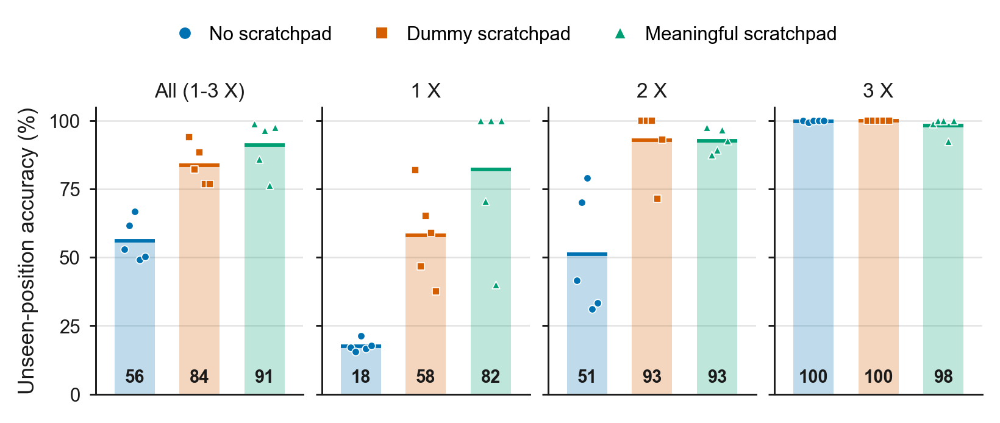
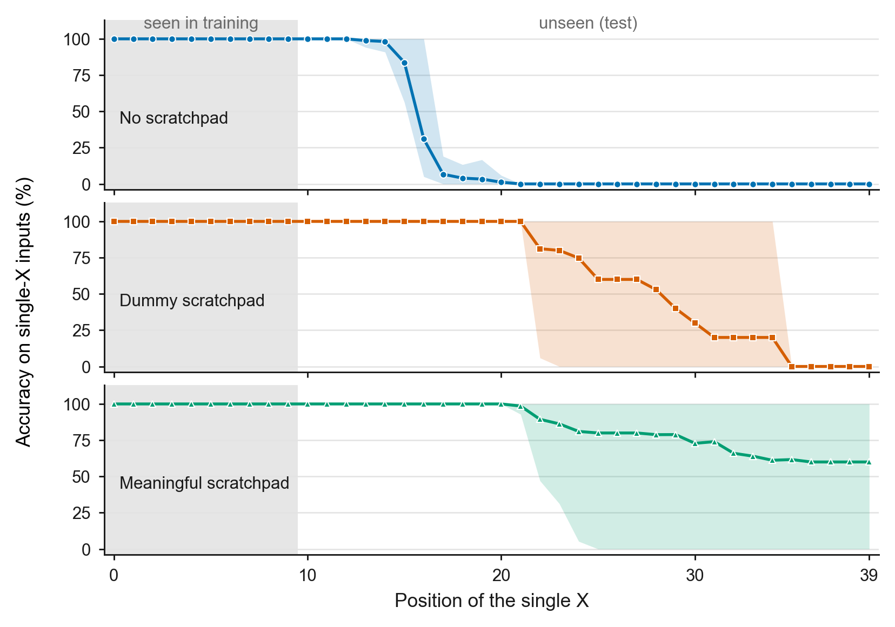
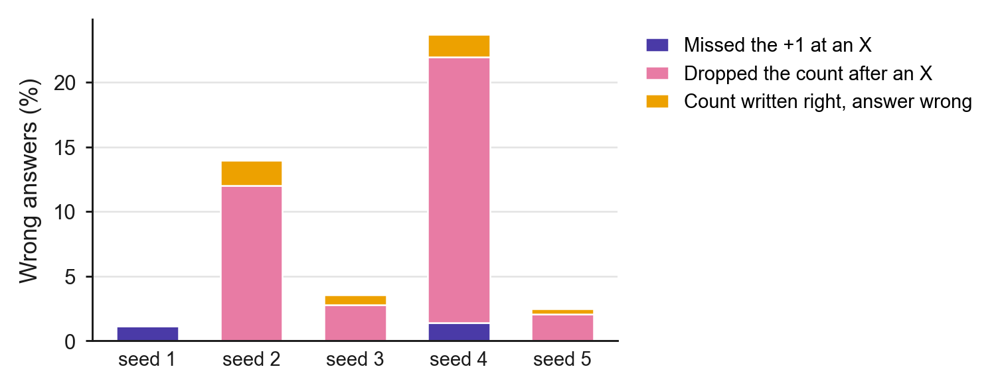

# Step 3: Scratchpad comparison with NoPE (length 40, train 0-9 / test 10-39)

**Date:** October 12, 2026
**Purpose:** Test whether writing a running count of `X`s (a meaningful scratchpad) lets a
NoPE model count `X`s at positions it never saw them in, on setting B from Step 2B,
where the plain model fails. A dummy scratchpad of the same length is the control.

## Activity summary

I implemented the dummy and meaningful scratchpads, added tests for both formats, and
trained all three conditions with five seeds on setting B. Every condition and seed was
100% on seen positions. On unseen positions (counts 1-3), the **meaningful scratchpad
reached 91.1%**, against 83.7% for the dummy scratchpad and 56.2% without one. The gap
is largest for a single `X` (82.1% vs 58.1% vs 17.6%). Three of five meaningful seeds
counted a lone `X` correctly at **every** unseen position, which no dummy or plain seed
did.

Two results need care. First, the **dummy scratchpad also helped a lot** (56.2% to
83.7%), even though its tokens carry no information, so part of the gain at NoPE comes
from the longer, interleaved format rather than from the count. Why is not known. In
the distance task the dummy scratchpad did the opposite (it lowered accuracy to 20.7%).
Second, the meaningful scratchpad did not reach 100% as it did in the distance task.
Most remaining errors have one form: the model **writes the `+1` at an unseen `X`
correctly, then drops back to the old count** at the next position.

## Experimental setup

- Data: setting B from Step 2B (length 40; `X` in positions 0-9 for training and
  validation, 10-39 for the test; 0-3 `X`s, 25% each; 50,000 / 5,000 / 2,000; data
  seed 1337).
- Model: NoPE, causal, 4 layers, 4 heads, embedding 128 (about 0.8M parameters); same
  for all three conditions. `block_size = 96` because scratchpad sequences are 82
  tokens; NoPE has no parameter that depends on it (the no-scratchpad condition
  reproduces Step 2B exactly).
- Seeds 1337-1341; 2,000 iterations; checkpoints at 500 / 1,000 / 1,500 / 2,000.
- Loss: only on what the model writes (the states and the answer), not on the input.
- Evaluation is free-running: the model writes each state itself and keeps it in the
  context, then answers after `:`.
- Metrics, fixed before running: unseen-position accuracy on counts 1-3 (main), each
  count separately, single-`X` accuracy by position, and the accuracy of the counts the
  model writes.

The three conditions on one real test input (`X` at 15 and 32, answer 2):

```text
no scratchpad   olwbpynbahfveyzXynujzcuvpmydmjyjXaqlurpg:2
dummy           #o#l#w#b#p#y#n#b#a#h#f#v#e#y#z#X#y#n#u#j# ... #m#j#y#j#X#a#q#l#u#r#p#g#:2
meaningful      0o0l0w0b0p0y0n0b0a0h0f0v0e0y0z0X1y1n1u1j1 ... 1m1j1y1j1X2a2q2l2u2r2p2g2:2
```

- **Dummy:** a `#` after every input letter. Same length as the meaningful version, no
  information.
- **Meaningful:** after every input letter, the number of `X`s read so far (`+1` at each
  `X`). The last count equals the answer.
- The leading `0` (or `#`) is always the same, so it is given, not predicted.

Commands:

```bash
../venv/bin/python -m unittest test_scratchpad
DATA_DIR=data/count_scratchpad_L40_seen10 BLOCK_SIZE=96 POS_TYPE=none CONDITIONS="no_scratchpad dummy meaningful" RUN_PREFIX=out_step3_nope RESULTS_CSV=results_step3_nope.csv PREDICTIONS_CSV=predictions_step3_nope.csv ./run_multiseed.sh
```

## Results

### Accuracy by number of `X`



[Vector PDF](figures/step3_nope_accuracy_by_count.pdf)

*Figure 1. Unseen-position accuracy at 2,000 iterations for each scratchpad condition
(NoPE, setting B). The first panel is the pre-set main metric (counts 1-3); the others
break it down by number of X. Bars and thick lines: mean over five seeds (value at the
bottom); markers: individual seeds. Every condition and seed scored 100% on seen
positions. The meaningful
scratchpad is highest for a single X, where three seeds are perfect; with two X, the
dummy and meaningful scratchpads are about equal; with three X, every condition is
near 100%.*

Final checkpoint (2,000 iterations), unseen positions:

| Condition | Seed | Seen positions | Counts 1-3 | k=1 | k=2 | k=3 |
|---|---|---:|---:|---:|---:|---:|
| No scratchpad | 1337 | 100% | 52.87% | 17.0% | 41.6% | 100% |
| | 1338 | 100% | 61.67% | 15.4% | 70.2% | 99.4% |
| | 1339 | 100% | 66.73% | 21.2% | 79.0% | 100% |
| | 1340 | 100% | 49.27% | 16.6% | 31.2% | 100% |
| | 1341 | 100% | 50.40% | 17.8% | 33.4% | 100% |
| | **Mean +/- SD** | 100% | **56.19 +/- 7.64%** | 17.6% | 51.1% | 99.9% |
| Dummy | 1337 | 100% | 94.00% | 82.0% | 100% | 100% |
| | 1338 | 100% | 82.27% | 46.8% | 100% | 100% |
| | 1339 | 100% | 88.40% | 65.2% | 100% | 100% |
| | 1340 | 100% | 76.80% | 59.0% | 71.4% | 100% |
| | 1341 | 100% | 76.87% | 37.6% | 93.0% | 100% |
| | **Mean +/- SD** | 100% | **83.67 +/- 7.49%** | 58.1% | 92.9% | 100% |
| Meaningful | 1337 | 100% | 98.87% | 100% | 97.6% | 99.0% |
| | 1338 | 100% | 86.07% | 70.6% | 87.6% | 100% |
| | 1339 | 100% | 96.47% | 100% | 89.4% | 100% |
| | 1340 | 100% | 76.33% | 40.0% | 96.6% | 92.4% |
| | 1341 | 100% | 97.53% | 100% | 92.6% | 100% |
| | **Mean +/- SD** | 100% | **91.05 +/- 9.67%** | 82.1% | 92.8% | 98.3% |

Count 0 was 100% for every condition and seed. Paired by seed, the meaningful
scratchpad beat no scratchpad in all five seeds and beat the dummy scratchpad in four
(seed 1340: 76.33% vs 76.80%).

### Where a lone `X` is lost



[Vector PDF](figures/step3_nope_position_accuracy.pdf)

*Figure 2. Accuracy on inputs with a single X, by the X's position, for each condition
(NoPE, setting B). Positions are numbered from 0 (0-39). Line: mean over five seeds;
band: range across seeds; gray: positions seen in training. Without a scratchpad, every
seed loses a lone X near position 16. The dummy scratchpad moves that point to 22-35,
depending on the seed, but every seed still has one. With the meaningful scratchpad,
three seeds count a lone X at every unseen position; the other two stop at 22 and 32,
which is why the mean levels off at 60%.*

First unseen position where single-`X` accuracy falls below 50%:

| Condition | 1337 | 1338 | 1339 | 1340 | 1341 |
|---|---:|---:|---:|---:|---:|
| No scratchpad | 16 | 16 | 17 | 16 | 16 |
| Dummy | 35 | 25 | 31 | 29 | 22 |
| Meaningful | never (100%) | 32 | never (100%) | 22 | never (100%) |

### What the meaningful scratchpad writes

On seen positions every seed wrote every count correctly. On unseen positions:

| Seed | Counts written correctly | Count right after an `X` | Whole trace correct | Answer = last written count |
|---:|---:|---:|---:|---:|
| 1337 | 99.88% | 99.27% | 99.15% | 100% |
| 1338 | 98.77% | 100% | 85.90% | 98.55% |
| 1339 | 99.77% | 100% | 97.25% | 99.45% |
| 1340 | 95.29% | 98.73% | 72.90% | 98.70% |
| 1341 | 99.84% | 100% | 97.95% | 99.65% |
| **Mean** | 98.71% | 99.60% | 90.63% | 99.27% |

The count right after an `X` is almost always correct (99.6%), so the model does see
an `X` at unseen positions and adds 1. The failures come one step later. A typical wrong
trace (seed 1340, single `X` at position 33):

```text
position        0-9         10-19       20-29       30-39
input           comdozdpoe  ehyzhhyypy  pklnihnmls  hkkXdidyid
correct count   0000000000  0000000000  0000000000  0001111111
model wrote     0000000000  0000000000  0000000000  0001000000    answer 0
```

The model writes `1` under the `X`, then goes back to `0` and answers 0.



[Vector PDF](figures/step3_nope_meaningful_errors.pdf)

*Figure 3. Wrong answers of the meaningful scratchpad on unseen inputs with 1-3 X
(NoPE, seeds 1-5 = 1337-1341), split by where the model's own trace first goes wrong:
it wrote the old count at an X (missed the +1), it wrote a lower count at a non-X
position after the +1 (dropped the count), or every count was right but the final
answer was not.*

| Seed | Missed the `+1` at an `X` | Dropped the count after an `X` | Counts right, answer wrong | Total (of 1,500) |
|---:|---:|---:|---:|---:|
| 1337 | 17 | 0 | 0 | 17 |
| 1338 | 0 | 180 | 29 | 209 |
| 1339 | 0 | 42 | 11 | 53 |
| 1340 | 21 | 308 | 26 | 355 |
| 1341 | 0 | 31 | 6 | 37 |
| **All** | 38 (6%) | 561 (84%) | 72 (11%) | 671 |

### Training length

Mean unseen accuracy (counts 1-3) across checkpoints:

| Condition | 500 | 1,000 | 1,500 | 2,000 |
|---|---:|---:|---:|---:|
| No scratchpad | 55.11% | 55.31% | 55.60% | 56.19% |
| Dummy | 85.71% | 85.12% | 84.32% | 83.67% |
| Meaningful | 92.83% | 91.76% | 91.60% | 91.05% |

Both scratchpads are best at 500 iterations and drift down slightly with more training.

### Comparison with the distance task

Same model and seeds, NoPE, unseen-position accuracy at 2,000 iterations:

| Task | No scratchpad | Dummy | Meaningful |
|---|---:|---:|---:|
| Distance (dist >= 5, length 20) | 67.39% | 20.71% | 100% (5 of 5 seeds) |
| Counting (setting B, length 40) | 56.19% | 83.67% | 91.05% (3 of 5 seeds perfect on a lone `X`) |

## Conclusion

**What worked:** The meaningful scratchpad gave the best unseen-position accuracy
overall and for a single `X` (tying the dummy scratchpad on two `X`s), and it removed
the position limit entirely in three of five seeds: those seeds counted a lone `X` at
all 30 unseen positions. The
written counts show that the model recognizes an `X` at unseen positions and adds 1
almost every time (99.6%).

**What didn't work:** Two seeds still lost a lone `X` far from the training region, and
84% of the remaining errors have the same form: the model writes the `+1` and then
drops back to the old count. The dummy scratchpad also gave a large gain without
carrying any information, so at NoPE the comparison does not cleanly separate the
effect of the count from the effect of the longer format. Neither result is explained
yet.

**Next:** Step 4 repeats the same three conditions with RoPE, which also answers the
meeting note's question of whether RoPE already generalizes without a scratchpad.
