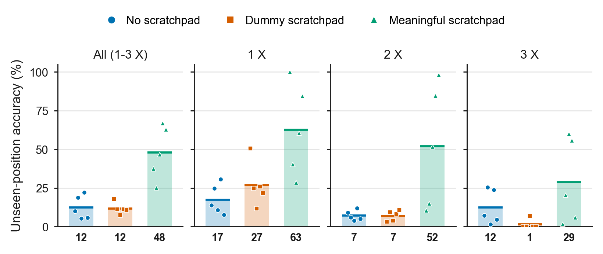
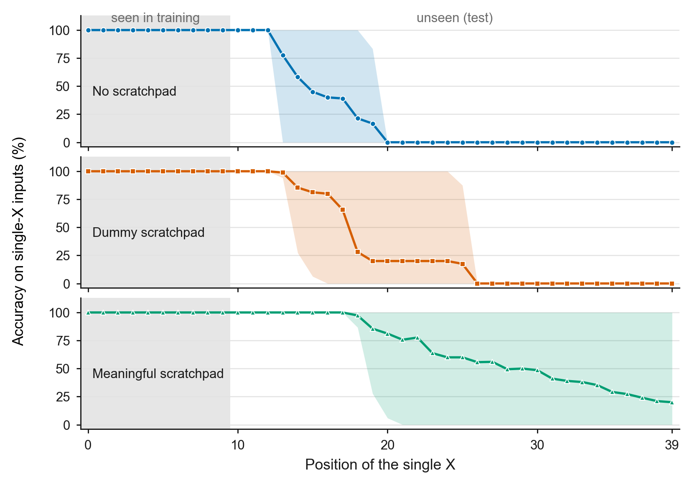
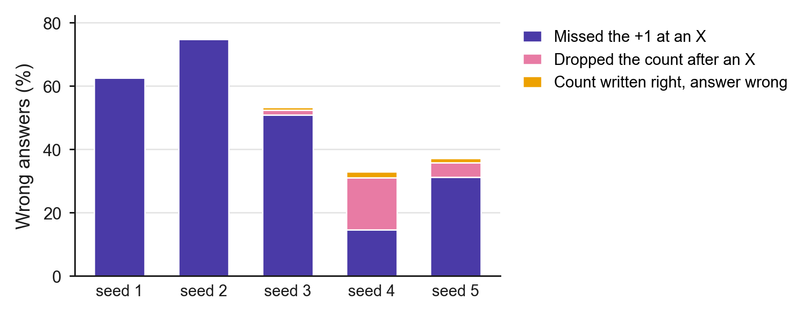

# Step 4: Scratchpad comparison with RoPE (length 40, train 0-9 / test 10-39)

**Date:** October 12-13, 2026
**Purpose:** Repeat Step 3 with RoPE instead of NoPE, on the same data, seeds, and
conditions. This also answers the meeting note's question: does RoPE already count
`X`s at unseen positions without a scratchpad?

## Activity summary

**RoPE does not generalize without a scratchpad.** It scored **12.4%** on unseen
positions (counts 1-3), far below NoPE's 56.2% and below the 25% of random guessing,
because it consistently under-counts. Unlike NoPE, it also fails on three `X`s.

The **dummy scratchpad did nothing** for RoPE (11.7%), unlike at NoPE where it raised
accuracy to 83.7%. The **meaningful scratchpad raised accuracy to 47.9%** and beat both
other conditions in every seed. Because the dummy gives no gain here, the improvement
comes from writing the count itself, which separates the two effects more cleanly than
at NoPE.

Still, the meaningful scratchpad is far from the 100% it reached in the distance task
with RoPE. Its failures are mostly **the opposite of NoPE's**: where NoPE adds 1 and
then loses the count, RoPE usually keeps the count but **does not add 1 when it reads
an `X` at an unseen position** (90% of its errors; one seed, 1340, also often loses the
count). Which `+1` fails (the first, second, or third `X`) depends on the seed.

## Experimental setup

Identical to Step 3 except for the positional encoding:

- Data: setting B (length 40; `X` in positions 0-9 for training and validation, 10-39
  for the test; 0-3 `X`s, 25% each; 50,000 / 5,000 / 2,000; data seed 1337).
- Model: **RoPE**, causal, 4 layers, 4 heads, embedding 128 (about 0.8M parameters).
  `block_size = 96`; RoPE's rotations are computed, not learned, so nothing trained
  depends on it.
- Conditions: no scratchpad, dummy (`#` after every letter), meaningful (running count
  of `X`s after every letter); formats as in Step 3.
- Seeds 1337-1341; 2,000 iterations; checkpoints at 500 / 1,000 / 1,500 / 2,000;
  free-running evaluation; same pre-set metrics as Step 3.

Command:

```bash
DATA_DIR=data/count_scratchpad_L40_seen10 BLOCK_SIZE=96 POS_TYPE=rope CONDITIONS="no_scratchpad dummy meaningful" RUN_PREFIX=out_step4_rope RESULTS_CSV=results_step4_rope.csv PREDICTIONS_CSV=predictions_step4_rope.csv ./run_multiseed.sh
```

## Results

### Accuracy by number of `X`



[Vector PDF](figures/step4_rope_accuracy_by_count.pdf)

*Figure 1. Unseen-position accuracy at 2,000 iterations for each scratchpad condition
(RoPE, setting B). The first panel is the pre-set main metric (counts 1-3); the others
break it down by number of X. Bars and thick lines: mean over five seeds (value under
each bar); markers: individual seeds. Every condition and seed scored 100% on seen
positions. Without a scratchpad or with the dummy scratchpad, accuracy is low for every
count. The meaningful scratchpad is highest for every count, but its seeds are spread
widely, and accuracy falls as the number of X grows.*

Final checkpoint (2,000 iterations), unseen positions:

| Condition | Seed | Seen positions | Counts 1-3 | k=1 | k=2 | k=3 |
|---|---|---:|---:|---:|---:|---:|
| No scratchpad | 1337 | 100% | 10.00% | 13.8% | 9.0% | 7.2% |
| | 1338 | 100% | 18.67% | 24.6% | 6.0% | 25.4% |
| | 1339 | 100% | 5.27% | 10.6% | 3.8% | 1.4% |
| | 1340 | 100% | 22.07% | 30.6% | 11.8% | 23.8% |
| | 1341 | 100% | 5.73% | 7.6% | 5.0% | 4.6% |
| | **Mean +/- SD** | 100% | **12.35 +/- 7.65%** | 17.4% | 7.1% | 12.5% |
| Dummy | 1337 | 100% | 17.93% | 50.6% | 3.2% | 0.0% |
| | 1338 | 100% | 11.27% | 24.6% | 9.2% | 0.0% |
| | 1339 | 100% | 7.40% | 11.6% | 3.8% | 6.8% |
| | 1340 | 100% | 11.27% | 25.8% | 8.0% | 0.0% |
| | 1341 | 100% | 10.73% | 21.6% | 10.6% | 0.0% |
| | **Mean +/- SD** | 100% | **11.72 +/- 3.83%** | 26.8% | 7.0% | 1.4% |
| Meaningful | 1337 | 100% | 37.40% | 100% | 10.4% | 1.8% |
| | 1338 | 100% | 25.27% | 40.4% | 15.0% | 20.4% |
| | 1339 | 100% | 46.73% | 28.4% | 51.8% | 60.0% |
| | 1340 | 100% | 67.00% | 60.4% | 84.8% | 55.8% |
| | 1341 | 100% | 62.87% | 84.4% | 98.2% | 6.0% |
| | **Mean +/- SD** | 100% | **47.85 +/- 17.41%** | 62.7% | 52.0% | 28.8% |

Count 0 was 100% for every condition and seed, and every wrong answer was an
under-count. Paired by seed, the meaningful scratchpad beat both no scratchpad and the
dummy scratchpad in all five seeds.

### Where a lone `X` is lost



[Vector PDF](figures/step4_rope_position_accuracy.pdf)

*Figure 2. Accuracy on inputs with a single X, by the X's position, for each condition
(RoPE, setting B). Positions are numbered from 0 (0-39). Line: mean over five seeds;
band: range across seeds; gray: positions seen in training. Without a scratchpad, seeds
lose a lone X between positions 13 and 20; the dummy scratchpad moves this only
slightly (14-26). With the meaningful scratchpad, one seed counts a lone X at every
unseen position and the others hold on longer (to 19-35) before dropping to 0, so the
mean declines across the whole unseen range.*

First unseen position where single-`X` accuracy falls below 50%:

| Condition | 1337 | 1338 | 1339 | 1340 | 1341 |
|---|---:|---:|---:|---:|---:|
| No scratchpad | 15 | 18 | 14 | 20 | 13 |
| Dummy | 26 | 18 | 14 | 18 | 17 |
| Meaningful | never (100%) | 23 | 19 | 28 | 35 |
| *(NoPE meaningful, Step 3)* | *never* | *32* | *never* | *22* | *never* |

### What the meaningful scratchpad writes

On seen positions every seed wrote every count correctly. On unseen positions:

| Seed | Counts written correctly | Count right after an `X` | Whole trace correct | Answer = last written count |
|---:|---:|---:|---:|---:|
| 1337 | 86.86% | 56.23% | 53.05% | 100% |
| 1338 | 83.72% | 42.90% | 43.95% | 99.95% |
| 1339 | 87.36% | 56.23% | 60.70% | 99.35% |
| 1340 | 96.03% | 89.47% | 76.75% | 97.85% |
| 1341 | 95.42% | 84.03% | 73.15% | 98.85% |
| **Mean** | 89.88% | 65.77% | 61.52% | 99.20% |
| *(NoPE, Step 3)* | *98.71%* | *99.60%* | *90.63%* | *99.27%* |

The count right after an `X` is where RoPE fails (65.8%, vs 99.6% for NoPE). Splitting
it by which `X` is being counted (only where the model's previous count was correct):

| Seed | 1st `X` (0 to 1) | 2nd `X` (1 to 2) | 3rd `X` (2 to 3) |
|---:|---:|---:|---:|
| 1337 | 100% | 18% | 7% |
| 1338 | 64% | 29% | 71% |
| 1339 | 50% | 100% | 97% |
| 1340 | 100% | 96% | 61% |
| 1341 | 100% | 100% | 6% |

Which step fails varies by seed: the first `X` for 1339 (and partly 1338), the second
for 1337 and 1338, the third for 1341 (and partly 1340). Seed 1337, for example,
counts a lone `X` at every unseen position but almost never adds 1 for a second `X`:

```text
position        0-9         10-19       20-29       30-39
input           offneactnz  gXuydacsbg  lfipebXezp  yyadfbeisl
correct count   0000000000  0111111111  1111112222  2222222222
model wrote     0000000000  0111111111  1111111111  1111111111    answer 1
```

In seeds 1337 and 1338, the second and third `+1` fail more often when the previous
`X` is 10 or more positions back, a gap never seen in training (correct: 27% vs 2% for
1337, 49% vs 19% for 1338), but seeds 1339-1341 do not show this. The cause is open.



[Vector PDF](figures/step4_rope_meaningful_errors.pdf)

*Figure 3. Wrong answers of the meaningful scratchpad on unseen inputs with 1-3 X
(RoPE, seeds 1-5 = 1337-1341), split by where the model's own trace first goes wrong:
at an X it did not add 1 (it wrote the old count, except 219 cases where it wrote 1 at
the third X), it wrote a lower count at a non-X position after the +1, or every count
was right but the final answer was not. In four of five seeds almost every error starts
with a missed +1 at an X; seed 1340 splits between a missed +1 and a dropped count. At
NoPE, almost every error started with a dropped count.*

| Seed | Missed the `+1` at an `X` | Dropped the count after an `X` | Counts right, answer wrong | Total (of 1,500) |
|---:|---:|---:|---:|---:|
| 1337 | 939 | 0 | 0 | 939 |
| 1338 | 1,121 | 0 | 0 | 1,121 |
| 1339 | 763 | 23 | 13 | 799 |
| 1340 | 219 | 246 | 30 | 495 |
| 1341 | 470 | 67 | 20 | 557 |
| **All** | 3,512 (90%) | 336 (9%) | 63 (2%) | 3,911 |
| *(NoPE, Step 3)* | *38 (6%)* | *561 (84%)* | *72 (11%)* | *671* |

### Training length

Mean unseen accuracy (counts 1-3) across checkpoints:

| Condition | 500 | 1,000 | 1,500 | 2,000 |
|---|---:|---:|---:|---:|
| No scratchpad | 12.29% | 12.20% | 12.40% | 12.35% |
| Dummy | 11.11% | 10.95% | 11.24% | 11.72% |
| Meaningful | 47.16% | 47.36% | 48.49% | 47.85% |

All three are flat, so longer training is unlikely to close the gap.

### NoPE vs RoPE


[Vector PDF](figures/step4_nope_vs_rope_accuracy_by_count.pdf)

*Figure 4. Step 3 (NoPE, top) and Step 4 (RoPE, bottom) side by side, same panels as
Figure 1. Bars: mean over five seeds (value under each bar); markers: individual
seeds. In both, the meaningful scratchpad is best overall. The dummy scratchpad helps
only at NoPE. With NoPE, accuracy rises with more X in every condition; with RoPE, it
mostly falls.*

| | No scratchpad | Dummy | Meaningful | Main failure of meaningful |
|---|---:|---:|---:|---|
| NoPE (Step 3) | 56.19% | 83.67% | 91.05% | drops the count after a `+1` |
| RoPE (Step 4) | 12.35% | 11.72% | 47.85% | misses the `+1` at an unseen `X` (4 of 5 seeds) |

Comparison with the distance task (same model and seeds, RoPE, 2,000 iterations):

| Task | No scratchpad | Dummy | Meaningful |
|---|---:|---:|---:|
| Distance (dist >= 5, length 20) | 49.45% | 52.09% | 100% (5 of 5 seeds) |
| Counting (setting B, length 40) | 12.35% | 11.72% | 47.85% |

## Conclusion

**What worked:** The meaningful scratchpad improved RoPE in every seed (12.4% to
47.9%), and since the dummy scratchpad gave no gain, this improvement comes from
writing the count. One seed counted a lone `X` at every unseen position.

**What didn't work:** RoPE without a scratchpad does not generalize to unseen positions
(12.4%), which answers the meeting note's question. With the meaningful scratchpad it
still often fails to add 1 at an unseen `X`, and which step fails changes from seed to
seed. Counting is much harder than the distance task for RoPE, where the meaningful
scratchpad reached 100%.

**Open questions (for discussion before any new runs):**

1. Why does the dummy scratchpad help NoPE so much but not RoPE?
2. Why does NoPE find more `X`s easier, while RoPE finds them harder?
3. Why do the two encodings fail at different steps of the same scratchpad: NoPE
   loses the count after writing it, RoPE fails to increase it?
