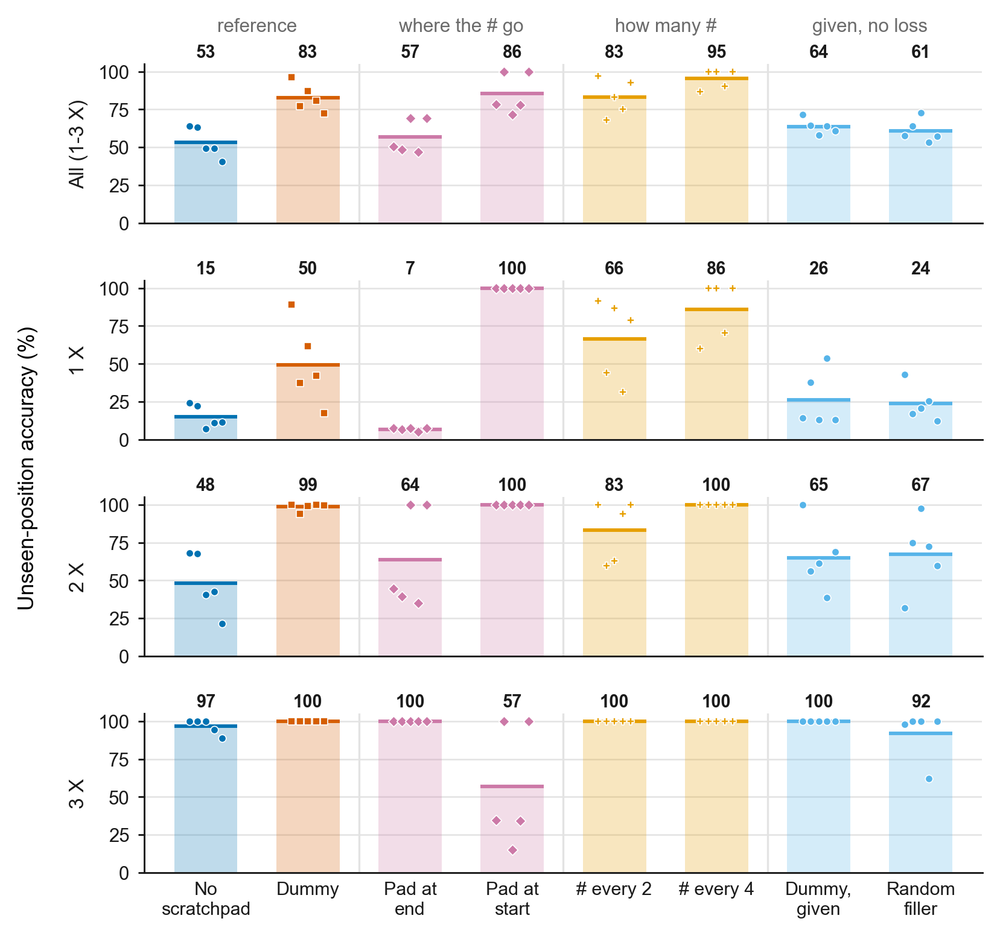
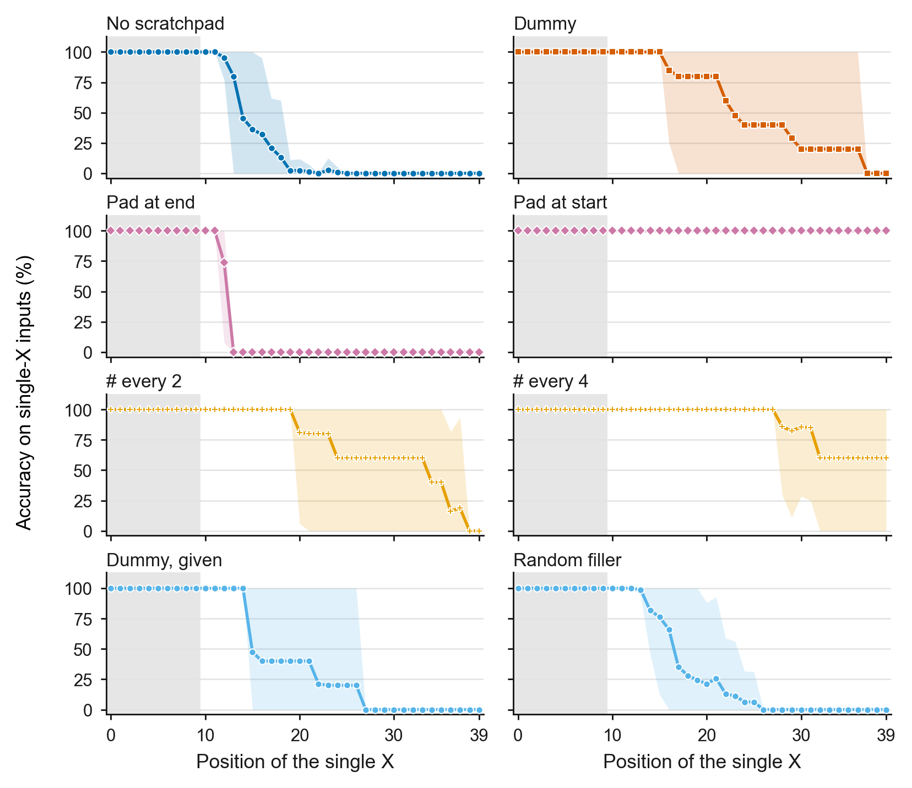

# Step 5: Why the dummy scratchpad helps, with NoPE (length 40, train 0-9 / test 10-39)

**Date:** October 29-30, 2026
**Purpose:** In Step 3 the dummy scratchpad (`#` after every input letter) raised NoPE's
unseen-position accuracy from 56.2% to 83.7%, although its tokens carry no information.
This step tests the three ideas from the October 16 meeting for why: random symbols
instead of `#`, fewer `#`, and moving all the `#` to one side of the input. The
hypothesis was that the extra tokens give the model more room to compute.

**Terms used below:**

- **Written vs given.** A *written* token is a training target: the model is trained to
  predict it, and at test time it generates the token itself. A *given* token is part of
  the input: there is no loss on it, and at test time it is supplied.
- **Counts 1-3** (the main metric): accuracy on unseen positions over inputs with 1, 2,
  or 3 `X`s. **k=1, k=2, k=3**: inputs with exactly that many `X`s. Inputs with no `X`
  have no `X` position, so they are reported separately (100% everywhere).
- **Above / below:** higher or lower in at least 4 of 5 seeds, paired by seed;
  otherwise **about equal**. Fixed before running.

## Activity summary

I trained eight versions, five seeds each: no scratchpad and the dummy as references,
five new versions that test the meeting's ideas, and dummy given, the reference for the
random filler (all shown below). Every run was 100% on seen positions.

**More tokens alone do not explain the gain.** None of the four comparisons fixed
before running came out as that idea predicts. The clearest is the placement test: pad
at start, whose 41 `#` come before the input and cannot see it, is above no scratchpad
in all five seeds (85.6% vs 53.3%), while pad at end, whose 41 `#` come after the input,
is about equal to it (56.9%). More `#` did not help either: `#` every 4 (11 `#`) was the
best version (95.4%) and above `#` every 2 and the dummy, which were about equal to each
other. The random filler test is the weakest (61.0% vs 63.8% for dummy given).

**Training the model to write the `#` helps, at least in the dummy layout.** Dummy given
has the same sequence as the dummy, but its `#` are given, so the model never learns to
predict them. At test time both see exactly the same sequence (the dummy writes every
`#` correctly), yet dummy given reaches 63.8% against 82.7%, lower in all five seeds.
For pad at end, the first batch shows no such gap, so the effect may depend on the
layout.

**Not separated yet.** Every version that beats no scratchpad, the two given versions
included, puts the input letters at different sequence positions than without a
scratchpad, and starts with a token that is not an input letter. Pad at end does
neither, and it is the only version that does not help. This experiment cannot tell
which of the two matters. How far the letters move does not order the results: `#`
every 4 moves them least and is the best version.

Pad at start also has its own failure: it counts a lone `X` at every unseen position in
every seed, but in three seeds it often answers 2 when there are three `X`s, which even
no scratchpad gets right 96.6% of the time.

## Experimental setup

- Data: setting B as in Steps 3-4 (length 40; `X` in positions 0-9 for training and
  validation, 10-39 for the test; 0-3 `X`s, 25% each; 50,000 / 5,000 / 2,000; data seed
  1337). Rebuilt with one vocabulary of 43 tokens for every version: the 33 of Steps
  3-4 plus 10 symbols (`!$%&*+<=>?`) for the random filler. The strings and labels are
  the same as in Step 3.
- Model: NoPE, causal, 4 layers, 4 heads, embedding 128 (about 0.8M parameters),
  `block_size = 96`. The larger vocabulary changes the starting weights, so no
  scratchpad and the dummy are rerun, and every comparison is paired by seed within
  Step 5.
- Seeds 1337-1341; 2,000 iterations; checkpoints at 500 / 1,000 / 1,500 / 2,000.
- Loss: in the `#` versions every `#` is written, as in the Step 3 dummy, except the
  first token of a sequence, which is given because nothing comes before it. The model
  cannot predict a random symbol, so the random filler's symbols are given, and it is
  compared with dummy given, which follows the same rule. The answer is always written.
- Evaluation: free-running for the `#` versions (the model writes every `#` itself);
  one forward pass for the given versions.

The versions on one real test input (`X` at 15 and 32, answer 2):

```text
no scratchpad          olwbpynbahfveyzXynujzcuvpmydmjyjXaqlurpg:2
dummy, dummy given     #o#l#w#b#p#y#n#b#a#h#f#v#e#y#z#X#y# ... #j#X#a#q#l#u#r#p#g#:2
pad at end             olwbpynbahfveyzXynujzcuvpmydmjyjXaqlurpg###...###:2   (41 #)
pad at start           ###...###olwbpynbahfveyzXynujzcuvpmydmjyjXaqlurpg:2   (41 #)
# every 2              #ol#wb#py#nb#ah#fv#ey#zX#yn#uj#zc#uv#pm#yd#mj#yj#Xa#ql#ur#pg#:2
# every 4              #olwb#pynb#ahfv#eyzX#ynuj#zcuv#pmyd#mjyj#Xaql#urpg#:2
random filler          $o=l%w?b&p>y$n%b*a>h?f*v&e&y=z$X&y% ... =j+X!a?q>l%u*r*p!g?:2
```

| Version | Meeting idea | `#` written by the model | Tokens up to `:` |
|---|---|---:|---:|
| No scratchpad | reference | 0 | 41 |
| Dummy | reference | 40 (+1 given) | 82 |
| Pad at end | 3 (move the `#`) | 41 | 82 |
| Pad at start | 3 (move the `#`) | 40 (+1 given) | 82 |
| `#` every 2 | 2 (fewer `#`) | 20 (+1 given) | 62 |
| `#` every 4 | 2 (fewer `#`) | 10 (+1 given) | 52 |
| Dummy, given | reference for the random filler | 0 (41 given) | 82 |
| Random filler | 1 (random symbols) | 0 (41 given) | 82 |

**First batch (stopped).** A first batch (October 29) gave every `#` to the model, with
no loss on it. That is not how the scratchpad works in Steps 3-4, where the model writes
every state, so I stopped it after 14 runs and reran the `#` versions with the model
writing every `#`. Its no-scratchpad and dummy-given runs do not depend on that change
and are used as they are.

Commands:

```bash
../venv/bin/python -m unittest test_scratchpad
../venv/bin/python data/count_scratchpad/prepare.py --length=40 --seen_end=10 --random_symbols='!$%&*+<=>?' --out_dir=data/count_scratchpad_L40_seen10_step5
DATA_DIR=data/count_scratchpad_L40_seen10_step5 BLOCK_SIZE=96 POS_TYPE=none CONDITIONS="dummy pad_end pad_start every2 every4 random_filler" RUN_PREFIX=out_step5_nope RESULTS_CSV=results_step5b_nope.csv PREDICTIONS_CSV=predictions_step5b_nope.csv ./run_multiseed.sh
```

No scratchpad and dummy given come from the first batch (`results_step5_nope.csv`,
`predictions_step5_nope.csv`), which ran before the version names changed. The
equivalent command uses `CONDITIONS="no_scratchpad dummy_given"` with those file names.

## Results

### Accuracy by number of `X`



[Vector PDF](figures/step5_nope_accuracy_by_count.pdf)

*Figure 1. Unseen-position accuracy at 2,000 iterations for each version (NoPE,
setting B). The first row is the main metric (counts 1-3); the others break it down by
number of X. Bars and thick lines: mean over five seeds (value above each bar);
markers: individual seeds. Versions are grouped by what they test. What to look at: pad
at start is 100% on one and two X but drops on three X; pad at end is lowest on one X;
`#` every 4 is highest overall; the two given versions are below the dummy.*

Final checkpoint (2,000 iterations), unseen positions, mean over five seeds:

| Version | Counts 1-3 | k=1 | k=2 | k=3 |
|---|---:|---:|---:|---:|
| No scratchpad | 53.33 +/- 10.15% | 15.2% | 48.2% | 96.6% |
| Dummy | 82.68 +/- 9.31% | 49.5% | 98.5% | 100% |
| Pad at end | 56.91 +/- 11.31% | 6.9% | 63.8% | 100% |
| Pad at start | 85.59 +/- 13.42% | 100% | 100% | 56.8% |
| `#` every 2 | 83.25 +/- 12.10% | 66.4% | 83.3% | 100% |
| `#` every 4 | **95.37 +/- 6.46%** | 86.1% | 100% | 100% |
| Dummy, given | 63.81 +/- 5.03% | 26.4% | 65.0% | 100% |
| Random filler | 61.03 +/- 7.56% | 23.7% | 67.3% | 92.0% |

The reruns are close to Step 3 (dummy 82.68% vs 83.67%; no scratchpad 53.33% vs
56.19%), so the new vocabulary changes little.

Against the predictions fixed before running (counts 1-3, paired by seed):

| Version | If the extra tokens add computation | Result | Side |
|---|---|---|---|
| Pad at start | about equal to no scratchpad | above (higher in 5/5) | against it |
| Pad at end | above no scratchpad | about equal (higher in 2/5) | against it |
| `#` every 2, every 4 | more `#` is better | every 4 above every 2 (4/5) | against it |
| Random filler | about equal to dummy given | below (lower in 4/5) | against it (weak test) |

The strongest of these is pad at start (5/5). Pad at end is a null result, and the
random filler gap is small (61.0% vs 63.8%), so those two count for less.

Other comparisons (counts 1-3, paired by seed):

| Comparison | Result |
|---|---|
| Dummy, pad at start, `#` every 2, `#` every 4 vs no scratchpad | above (5/5 each) |
| Dummy given vs no scratchpad | above (5/5) |
| Random filler vs no scratchpad | above (4/5) |
| `#` every 4 vs dummy | above (4/5) |
| Pad at start vs dummy | about equal (higher in 2/5) |
| `#` every 2 vs dummy | about equal (higher in 2/5) |
| Pad at end vs dummy | below (5/5) |
| Dummy vs dummy given | above (5/5) |

<details>
<summary>Per-seed results (click to open)</summary>

| Version | Seed | Counts 1-3 | k=1 | k=2 | k=3 |
|---|---|---:|---:|---:|---:|
| No scratchpad | 1337 | 64.20% | 24.4% | 68.2% | 100% |
| | 1338 | 63.33% | 22.2% | 67.8% | 100% |
| | 1339 | 49.20% | 7.0% | 40.6% | 100% |
| | 1340 | 49.27% | 11.0% | 42.6% | 94.2% |
| | 1341 | 40.67% | 11.6% | 21.6% | 88.8% |
| Dummy | 1337 | 96.33% | 89.0% | 100% | 100% |
| | 1338 | 77.13% | 37.4% | 94.0% | 100% |
| | 1339 | 86.93% | 61.8% | 99.0% | 100% |
| | 1340 | 80.67% | 42.0% | 100% | 100% |
| | 1341 | 72.33% | 17.4% | 99.6% | 100% |
| Pad at end | 1337 | 50.67% | 7.6% | 44.4% | 100% |
| | 1338 | 48.67% | 6.6% | 39.4% | 100% |
| | 1339 | 69.20% | 7.6% | 100% | 100% |
| | 1340 | 46.80% | 5.2% | 35.2% | 100% |
| | 1341 | 69.20% | 7.6% | 100% | 100% |
| Pad at start | 1337 | 78.20% | 100% | 100% | 34.6% |
| | 1338 | 100.00% | 100% | 100% | 100% |
| | 1339 | 71.67% | 100% | 100% | 15.0% |
| | 1340 | 78.07% | 100% | 100% | 34.2% |
| | 1341 | 100.00% | 100% | 100% | 100% |
| `#` every 2 | 1337 | 97.13% | 91.4% | 100% | 100% |
| | 1338 | 67.93% | 44.0% | 59.8% | 100% |
| | 1339 | 83.20% | 86.8% | 62.8% | 100% |
| | 1340 | 75.13% | 31.4% | 94.0% | 100% |
| | 1341 | 92.87% | 78.6% | 100% | 100% |
| `#` every 4 | 1337 | 86.67% | 60.0% | 100% | 100% |
| | 1338 | 100.00% | 100% | 100% | 100% |
| | 1339 | 100.00% | 100% | 100% | 100% |
| | 1340 | 90.20% | 70.6% | 100% | 100% |
| | 1341 | 100.00% | 100% | 100% | 100% |
| Dummy, given | 1337 | 71.47% | 14.4% | 100% | 100% |
| | 1338 | 64.60% | 37.6% | 56.2% | 100% |
| | 1339 | 58.13% | 13.2% | 61.2% | 100% |
| | 1340 | 64.13% | 53.8% | 38.6% | 100% |
| | 1341 | 60.73% | 13.2% | 69.0% | 100% |
| Random filler | 1337 | 57.53% | 42.8% | 31.8% | 98.0% |
| | 1338 | 64.00% | 17.0% | 75.0% | 100% |
| | 1339 | 72.73% | 20.8% | 97.4% | 100% |
| | 1340 | 53.47% | 25.6% | 72.6% | 62.2% |
| | 1341 | 57.40% | 12.4% | 59.8% | 100% |

</details>

### Where a lone `X` is lost



[Vector PDF](figures/step5_nope_position_accuracy.pdf)

*Figure 2. Accuracy on inputs with a single X, by the X's position, for each version
(NoPE, setting B). Positions are numbered from 0 (0-39). Line: mean over five seeds;
band: range across seeds; gray: positions seen in training. The versions being compared
sit side by side. In most versions each seed drops from about 100% to about 0% within a
few positions, each at its own position, so the mean falls in steps. What to look at:
pad at start stays at 100% everywhere; pad at end drops at position 12-13 in every seed
(no scratchpad: 13-19); `#` every 4 keeps the highest mean among the versions that drop.*

First unseen position where single-`X` accuracy falls below 50%:

| Version | 1337 | 1338 | 1339 | 1340 | 1341 |
|---|---:|---:|---:|---:|---:|
| No scratchpad | 19 | 17 | 13 | 14 | 14 |
| Dummy | 37 | 22 | 29 | 23 | 16 |
| Pad at end | 13 | 13 | 13 | 12 | 13 |
| Pad at start | never | never | never | never | never |
| `#` every 2 | 38 | 24 | 36 | 20 | 34 |
| `#` every 4 | 28 | never | never | 32 | never |
| Dummy, given | 15 | 22 | 15 | 27 | 15 |
| Random filler | 24 | 16 | 17 | 17 | 14 |

As in Step 3, every wrong answer on a lone `X` is 0, in every version.

In Step 3, every dummy seed was 0% for a lone `X` at positions 35-39, right before `:`.
Pad at end was meant to test whether that comes from the `X` being right before `:`,
since it puts 41 `#` in between. But pad at end already fails from position 12-13, so it
cannot answer that.

### Pad at start and three `X`s

Pad at start answers counts 1 and 2 correctly in every seed, but count 3 is 34.6%,
15.0%, and 34.2% in seeds 1337, 1339, and 1340 (100% in 1338 and 1341). Every wrong
count-3 answer is 2. Without a scratchpad, count 3 is 96.6%, so this is something pad
at start loses that even the plain model keeps. In the three failing seeds, it gets
worse the later the last `X` is:

| Last `X` at | 15-19 | 20-24 | 25-29 | 30-34 | 35-39 |
|---|---:|---:|---:|---:|---:|
| Count-3 accuracy | 100% | 90% | 51% | 20% | 4% |
| Inputs | 33 | 153 | 249 | 489 | 573 |

(Three inputs in these seeds have their last `X` at 10-14; all are correct.)

### What the model writes

Every version that writes `#` wrote it correctly on 100% of the slots at unseen
positions, except pad at end seed 1337 (99.97%). So the dummy and dummy given see the
same test sequences.

The random filler is the only version that ever answers above the true count (189
count-2 inputs answered 3, over all seeds).

### Training length

Mean unseen accuracy (counts 1-3) across checkpoints:

| Version | 500 | 1,000 | 1,500 | 2,000 |
|---|---:|---:|---:|---:|
| No scratchpad | 53.64% | 53.24% | 53.04% | 53.33% |
| Dummy | 83.88% | 83.16% | 82.73% | 82.68% |
| Pad at end | 59.57% | 58.04% | 57.29% | 56.91% |
| Pad at start | 88.60% | 86.37% | 85.77% | 85.59% |
| `#` every 2 | 84.05% | 83.31% | 82.95% | 83.25% |
| `#` every 4 | 93.45% | 94.31% | 95.16% | 95.37% |
| Dummy, given | 66.07% | 64.31% | 63.80% | 63.81% |
| Random filler | 65.81% | 63.36% | 61.95% | 61.03% |

As in Step 3, most versions are best at 500 iterations and drift down slightly. `#`
every 4 is the only one that improves with more training.

### First batch: `#` given, no loss (stopped)

| Version (`#` given, no loss) | Seeds | Counts 1-3 | k=1 | k=2 |
|---|---:|---:|---:|---:|
| No scratchpad | 5 | 53.33 +/- 10.15% | 15.2% | 48.2% |
| Dummy, given | 5 | 63.81 +/- 5.03% | 26.4% | 65.0% |
| Pad at end, given | 4 | 62.78 +/- 25.25% | 32.3% | 57.0% |

Pad at end, given, is 44.5%, 50.7%, 56.0%, and 100% by seed (seed 1341 was stopped).
With four seeds it is not compared formally, but it does not show the gap seen for the
dummy: its mean is above pad at end written (62.8% vs 56.9%; higher in 2 of 4 seeds),
and well above it on one `X` (32.3% vs 6.9%). So the benefit of training on the `#`
shows up in the dummy layout but not for pad at end.

### Run time

The 30 runs of the corrected batch took about 5 hours 15 minutes in sequence on CPU
(October 30, about 01:20-06:40). Training takes about 7 minutes per run; free-running
evaluation of four checkpoints takes the rest. The 82-token versions that write `#`
took 16-18 minutes per run, and `#` every 4 about 5 minutes. The first batch took about
2 hours 40 minutes.

## Conclusion

**What worked:** The step answered its question: more tokens alone do not explain why
the dummy helps. The clearest evidence is pad at start, whose `#` cannot see the input
yet is above no scratchpad in every seed. The step also separated one effect: with the
same test sequence, training the model to write the dummy's `#` (82.7%) beats giving
them (63.8%) in every seed. Two versions did better than the dummy in some way: pad at
start removed the position limit for a lone `X` in every seed (it is about equal to the
dummy on counts 1-3), and `#` every 4 was above the dummy (4/5) and the best version
overall (95.4%, three perfect seeds).

**What didn't work:** The cause is still not identified. Every version that helped puts
the input letters at new sequence positions and also starts with a token that is not
an input letter, and the versions here change both together; how far the letters move
does not order the results. The effect of writing the `#` does not hold for pad at end
(first batch, four seeds). Pad at start, the clearest gain for a lone `X`, undercounts
three `X`s in three seeds. Pad at end fails too early to test whether the dummy's late
drop comes from the `:`.

**Open questions (for discussion before any new runs):**

1. A check that separates the two causes: no scratchpad with one leading `#` (42 tokens,
   5 seeds), which adds the leading token but moves the input by only one position.
2. Why pad at start loses one of three `X`s, almost always when the last `X` is late.
3. Why fewer `#` (every 4) beats more (every 2 and the dummy).
4. Why training on the `#` helps the dummy layout but not pad at end.
