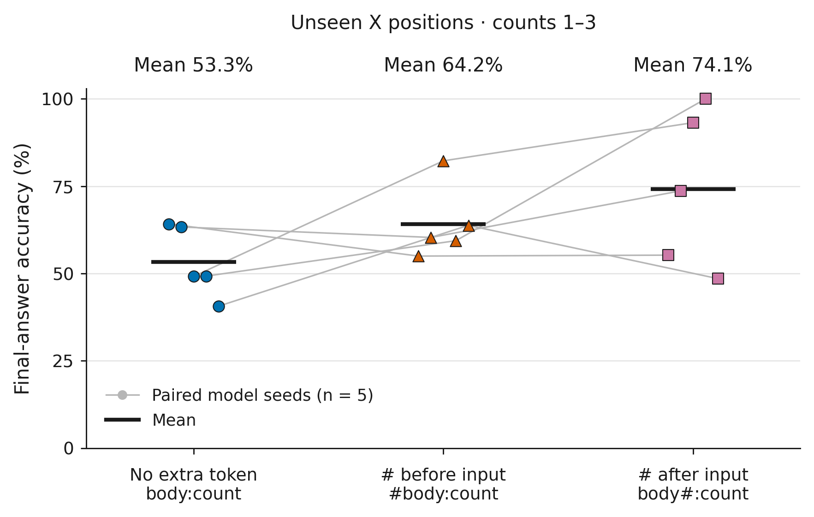
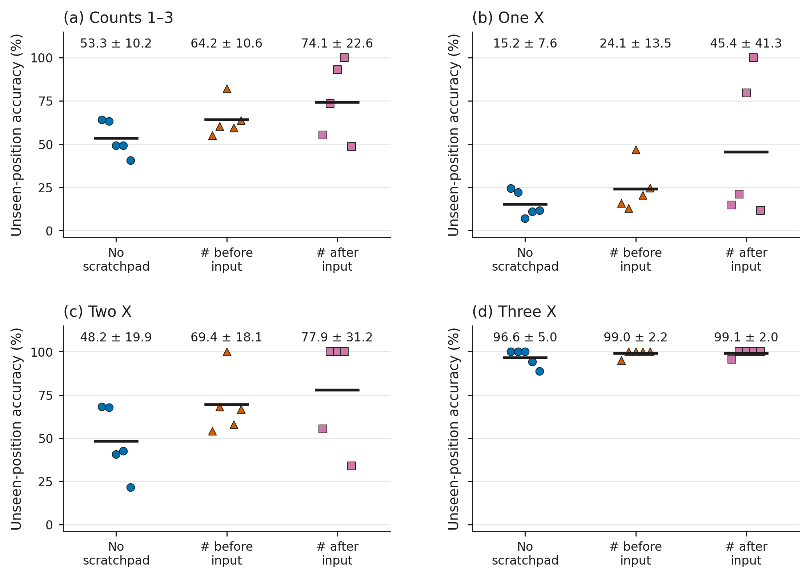
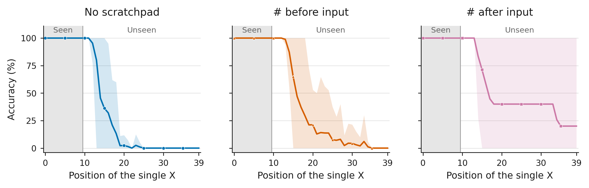

# Step 6: a single supplied token before or after the input

**Date:** November 8, 2026

## Activity summary

I completed ten new NoPE counting runs, comparing one supplied `#` before the body
with one supplied `#` after it. Both versions use answer-only loss and the same
40-character raw inputs as Step 5. Every new model reached 100% on seen positions.
On unseen positions, counts 1-3, the prefix averaged 64.16 +/- 10.60% and the suffix
74.13 +/- 22.61%, against the matched Step 5 baseline of 53.33 +/- 10.15%. The suffix
beat baseline and prefix in 4/5 paired seeds. A single suffix can therefore help
without a leading marker, shifting raw-token positions, or an auxiliary filler loss.
The effect is seed-sensitive and does not establish its internal mechanism.

## Setup fixed before training

The task is to read a 40-character body containing 0-3 Xs and output how many Xs it
contains. The other characters are filler letters. NoPE means that the transformer
uses no explicit positional encoding; its causal context can still depend on position.

The [pre-run plan](2026-11-08-step6-single-token-plan.md) records comparisons,
interpretation criteria, and hashes of the reused raw data and vocabulary metadata.

| Condition | Record | Input tokens up to delimiter | Loss |
|---|---|---:|---|
| No scratchpad (Step 5) | `body:count` | 41 | answer |
| Prefix (`prefix_one`) | `#body:count` | 42 | answer |
| Suffix (`suffix_one`) | `body#:count` | 42 | answer |

The `#` is supplied in training and evaluation; neither condition generates any state
tokens. The final answer is excluded from every model input. Both new conditions
have delimiter index 41, matching model sequence length and answer-query position.
The prefix moves the raw body to positions 1-40; the suffix keeps positions 0-39.

- Raw length 40 in every train, validation, and test example.
- `X` in 0-9 for train/validation; 10-39 for unseen test.
- Counts 0-3, balanced in each pool; count 0 is reported separately because it has no
  position shift.
- Exact Step 5 data seed 1337 and 43-token vocabulary; 50,000 / 5,000 / 2,000 examples.
- NoPE, causal, 4 layers, 4 heads, embedding 128, dropout 0, block size 96,
  0.799M parameters; unchanged optimizer/configuration from Step 5.
- Model seeds 1337-1341; 2,000 iterations; checkpoints 500/1,000/1,500/2,000.
- Fixed final checkpoint, with no selection using unseen accuracy.

The Step 5 baseline was reused after verifying all saved model/data metadata and the
ordered test examples. A full-data re-evaluation of baseline seed 1337 reproduced
its saved 64.20% unseen counts-1-3 accuracy. The checkpoint format lacks optimizer
settings/data hashes, so the remaining provenance comes from the unchanged training
program, config, and Step 5 record.

## Results



[Vector PDF](figures/step6_single_token_main.pdf)

*Figure 1. Final-answer accuracy on unseen X positions, counts 1-3, at the fixed
2,000-iteration checkpoint. Points are five model seeds and black horizontal bars
are means. Thin lines connect the same initialization seed across separately
trained formats, not stages of training one model. The raw body is always length
40; train X positions are 0-9 and test X positions are 10-39. Both added tokens are
supplied and only the answer receives loss. Count 0 and seen-position validation
are 100% for all three conditions and seeds.*

| Condition | Unseen counts 1-3 | k=1 | k=2 | k=3 |
|---|---:|---:|---:|---:|
| Baseline | 53.33 +/- 10.15% | 15.24% | 48.16% | 96.60% |
| Prefix | 64.16 +/- 10.60% | 24.08% | 69.40% | 99.00% |
| Suffix | 74.13 +/- 22.61% | 45.40% | 77.88% | 99.12% |

Per-seed primary accuracies and paired changes (percentage points):

| Seed | Baseline | Prefix | Suffix | Prefix - baseline | Suffix - baseline | Suffix - prefix |
|---|---:|---:|---:|---:|---:|---:|
| 1337 | 64.20% | 55.00% | 55.27% | -9.20 | -8.93 | +0.27 |
| 1338 | 63.33% | 60.33% | 73.67% | -3.00 | +10.33 | +13.33 |
| 1339 | 49.20% | 82.27% | 93.20% | +33.07 | +44.00 | +10.93 |
| 1340 | 49.27% | 59.40% | 100.00% | +10.13 | +50.73 | +40.60 |
| 1341 | 40.67% | 63.80% | 48.53% | +23.13 | +7.87 | -15.27 |
| Mean | 53.33% | 64.16% | 74.13% | +10.83 | +20.80 | +9.97 |

The suffix improves over baseline in 4/5 seeds and exceeds the prefix in 4/5 seeds.
The prefix improves over baseline in 3/5, which does not meet the pre-set 4/5
descriptive consistency rule. These counts are not a statistical-significance test;
no statistical equivalence is inferred for any comparison. All five model seeds
share one raw dataset seed.

Every error in the final validation/test predictions for all three conditions is
an under-count; no invalid answer or over-count was generated. The suffix's primary
scores span 48.53-100.00%, so a mean
alone would conceal substantial initialization dependence.

## Supporting figures

<details>
<summary>Count-specific accuracy and single-X position dependence</summary>



[Vector PDF](figures/step6_single_token_accuracy.pdf)

*Figure S1. Primary metric and count-specific final-answer accuracy. Points are
individual seeds; black bars are means. Annotations report mean +/- sample SD.
Panel (a) is counts 1-3 and panels (b-d) show each count separately.*



[Vector PDF](figures/step6_single_token_positions.pdf)

*Figure S2. Accuracy when exactly one X is present. Positions are zero-based raw-body
indices. Lines are means and shading is the full min-max range over five seeds.
Gray marks positions used in training. The suffix reaches 100% at every position in
one seed and remains accurate farther into the unseen region in another, but other
seeds still miss late Xs. The prefix leaves a strong late-position failure.*

</details>

## Training budget

Mean unseen counts-1-3 accuracy across the fixed checkpoints:

| Condition | 500 | 1,000 | 1,500 | 2,000 |
|---|---:|---:|---:|---:|
| Baseline | 53.64% | 53.24% | 53.04% | 53.33% |
| Prefix | 64.88% | 64.05% | 63.92% | 64.16% |
| Suffix | 73.76% | 74.39% | 74.32% | 74.13% |

All three conditions are 100% on seen positions at every measured checkpoint. The
ranking of their means is stable; extra training does not remove seed dependence.

## Interpretation and remaining questions

This comparison narrows the Step 5 interpretation. A leading nonletter and shifted
raw-token indices are not necessary for an improvement: the suffix changes neither,
yet it beats baseline in 4/5 seeds. An auxiliary token-prediction loss is also not
necessary for this particular gain. Thus, one supplied token after the input can
change the learned solution and its transfer to unseen X positions.

This is compatible with a useful computation at the suffix representation, but does
not prove it. The suffix also changes the delimiter's position and the context of
the final readout. Its effect on optimization, representation, and readout could all
matter. The experiment does not establish an attention sink, explain every Step 5
layout, or show that a single suffix is as effective as a full dummy scratchpad.

The next analysis used frozen existing dummy models to test whether their
constant-token hidden vectors contain a linearly decodable running count. It is
now complete in the [Step 7 log](2026-11-08-step7-hidden-count-probes.md). That tests
available information, not causal use. No new training condition was selected or
launched on the basis of the most favorable seed here.

## Verification and reproducibility

- All 24 format/loss-mask unit tests passed, including the new prefix/suffix checks.
- Two-iteration full-data training/evaluation smoke tests passed for both formats.
- All 10 final checkpoints and 40 checkpoint evaluations completed.
- `analyze_step6.py` checked all 60 combined result rows and 105,000 final predictions
  (including 20 baseline rows and 35,000 baseline predictions), with no missing or
  duplicate groups, against the same ordered raw pools.
- Saved final model configurations and data metadata match the pre-run plan.
- During the final audit, all 105,000 saved final predictions were reproduced from
  the 15 checkpoints. Recomputed answer cross-entropy agreed with the rounded CSV
  values to within 0.000000578.
- The main figure and two supporting figures were rendered and visually inspected
  for labels and clipping. The main figure was added during presentation review;
  the underlying results and the original supporting figures are retained.
- Existing raw data, Step 5 result files, and unrelated untracked user files were
  preserved. New checkpoints and per-example diagnostics remain local/ignored.

Commands used for the completed run and analysis, from
`generalization-count-scratchpad/`:

```bash
bash run_step6.sh
MPLCONFIGDIR=/private/tmp/comp560-step6-mplcache \
XDG_CACHE_HOME=/private/tmp/comp560-step6-cache ../venv/bin/python analyze_step6.py
```

The analysis command can regenerate the summaries and figures. The training command
now intentionally refuses to overwrite existing outputs. To repeat training, choose
new values for `RUN_PREFIX`, `RESULTS_CSV`, and `PREDICTIONS_CSV`; point the analysis
arguments at those new files and runs as well.

Outputs: `results_step6_nope.csv`, `results_step6_summary.csv`,
`results_step6_paired.csv`, `predictions_step6_nope.csv`, and `log/figures/step6_*`.
