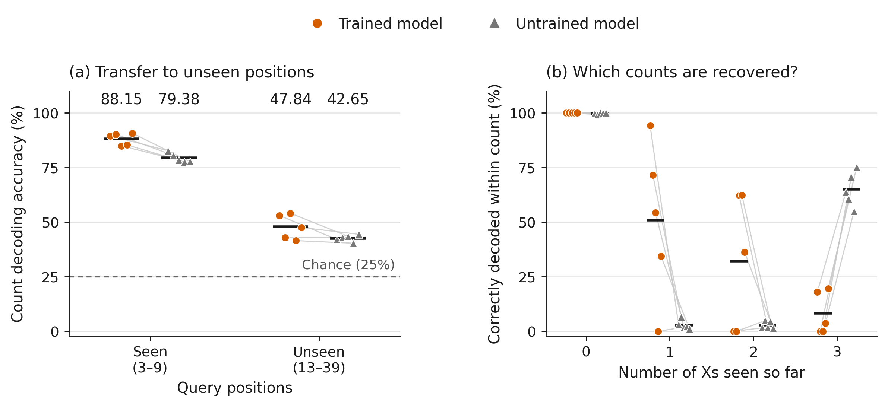
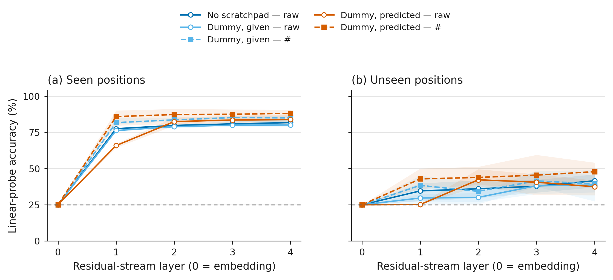
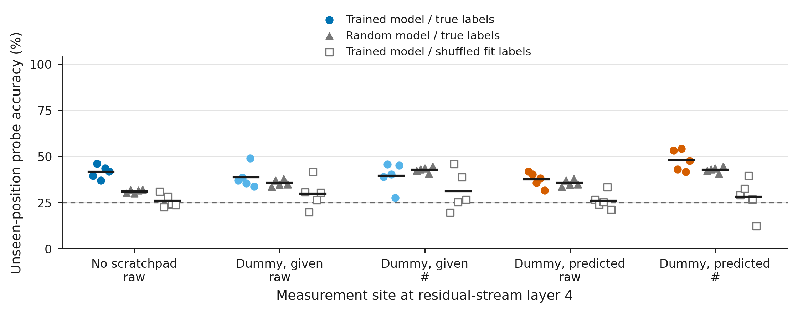
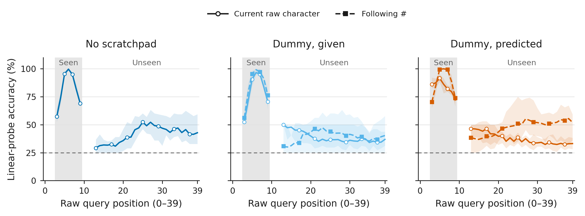

# Step 7: running-count information inside dummy-token representations

**Date:** November 8, 2026

## Activity summary

I analyzed the existing NoPE counting models without updating their weights. A small
linear classifier was trained to read the number of Xs seen so far from a hidden
vector, either at a raw input character or at the following constant `#`. For the
trained dummy model, the final-layer `#` readout reached 88.15 +/- 2.77% at seen
positions and 47.84 +/- 5.71% at unseen positions. Chance is 25%. However, a readout
from randomly initialized models already reached 42.65 +/- 1.55% at unseen `#`
positions. The visible token can therefore remain constant while its hidden vector
contains count-related information, but above-chance decoding alone does not show
that training created a counting algorithm or that the model uses this information
to produce its answer.

## Main figure



[Vector PDF](figures/step7_hidden_count_main.pdf)

*Figure 1. A linear classifier reads the hidden vector at `#` after block 4 in the
full interleaved dummy format. This is an internal-information diagnostic, separate
from final-answer accuracy. Trained models are the Step 5 dummy checkpoints;
untrained models have random transformer weights of the same architecture and
seed. Both remain frozen, and both sets of classifiers are fitted on seen queries
only. Points are the five model seeds and black bars are means. Thin lines pair
trained and untrained models with the same initialization seed within each pool
or count. Panel (a) compares seen queries 3-9 with unseen queries 13-39, over
balanced counts 0-3; uniform random
guessing is 25%. Panel (b) reports recall within each unseen count: high count-0
recall contributes substantially to the overall mean. All raw bodies have length
40. The full site, layer, and shuffled-label controls are retained below.*

## Question and fixed design

The [pre-run plan](2026-11-08-step7-probe-plan.md) fixes the pools, controls, linear
readout, and primary layer before extraction. These are representation diagnostics,
separate from the original task's final-answer scores.

- Existing Step 5 final checkpoints: no scratchpad, dummy given, and dummy predicted;
  five seeds 1337-1341 each. Dummy given and dummy predicted have identical token
  sequences; their original training losses differ.
- Same 40-character raw bodies, 43-token vocabulary, NoPE causal transformer,
  4 layers, 4 heads, embedding 128, block size 96, and 0.799M parameters.
- Each trained checkpoint is compared with a fresh random model of the same
  architecture and seed. Only the probe is fitted, including for random models.
- Measurement sites: the current raw character and, when present, the following
  `#`. Layer 0 is the embedding; layers 1-4 are the residual stream after each block,
  before final LayerNorm. Layer 4 is the fixed primary layer.
- Four-class ridge least-squares readout, fit-only feature standardization, fixed
  L2 coefficient 1.0 on the unnormalized sum-of-squares objective, free intercept.
  A separate probe is fitted for every model/site/layer.
- One shuffled-fit-label control per model seed, using a fixed shuffle. Evaluation
  labels remain correct. This is a diagnostic, not a permutation significance test.
- No layer or hyperparameter was selected using unseen-position scores.

### Balanced independent probe pools

Each query is a non-X character. For every query position and filler template,
there are four examples with 0, 1, 2, or 3 Xs before the query, the same current
letter, and no X after the query. The four X sets are nested within each template.
Counts are exactly balanced at every query position. All raw bodies are unique
across pools and excluded from the original model train/validation/test data.

| Pool | Query positions (zero-based) | X positions | Examples |
|---|---|---|---:|
| Probe fit | 3-9 | Before query, within 0-9 | 1,792 |
| Seen validation | 3-9 | Before query, within 0-9 | 896 |
| Unseen test | 13-39 | Before query, within 10-39 | 3,456 |

Here seen/unseen distinguishes the classifier's fit-query range and the original
X-placement regions. The transformer sees filler tokens at all 40 raw positions
during its original training; entire sequence positions were not removed.

Raw length is always 40. Queries 10-12 are omitted because they cannot have three
earlier unseen X positions while remaining non-X themselves. Consequently, actual
X placements in these pools range over 0-8 for fit/seen and 10-38 for unseen: the
last slot of each original X region cannot precede a query in its own region.
This diagnostic does not directly test an X at raw position 9 or 39. The answer token is
never included in the model input, and causal masking prevents a query vector from
using future tokens, the delimiter, or the answer. Here the running count equals
the final count by construction. This deliberately tests state maintenance at a
non-X character; it does not test the increment operation at X or cover every
prefix state encountered in the original task.

## Primary results

Accuracy in percent, mean +/- sample SD across the five model seeds. All four
counts contribute equally, so accuracy equals macro recall. All models share one
probe-pool seed (20261108) and one original raw-data seed (1337).

| Model and site | Trained, seen | Trained, unseen | Random model, unseen | Trained / shuffled fit labels, unseen |
|---|---:|---:|---:|---:|
| No scratchpad, raw | 81.74 +/- 1.27 | 41.56 +/- 3.49 | 30.97 +/- 1.03 | 25.86 +/- 3.64 |
| Dummy given, raw | 80.09 +/- 0.82 | 38.63 +/- 6.00 | 35.48 +/- 1.75 | 29.69 +/- 7.95 |
| Dummy given, `#` | 84.98 +/- 2.29 | 39.45 +/- 7.35 | 42.65 +/- 1.55 | 31.08 +/- 10.79 |
| Dummy predicted, raw | 83.79 +/- 3.09 | 37.44 +/- 4.05 | 35.48 +/- 1.75 | 25.96 +/- 4.50 |
| Dummy predicted, `#` | 88.15 +/- 2.77 | 47.84 +/- 5.71 | 42.65 +/- 1.55 | 27.96 +/- 10.05 |

At `#`, the trained dummy exceeds its paired random control by 5.19 percentage
points on average. The direction is positive in 5/5 seeds, but one difference is
only 0.029 points. It exceeds trained dummy given by 8.39 points on average, in
4/5 seeds. These are descriptive comparisons, not statistical-significance claims.
The random dummy and random dummy-given controls are identical because both their
initial weights and their input formats are identical.

| Seed | Dummy predicted, unseen `#` probe |
|---|---:|
| 1337 | 53.07% |
| 1338 | 42.91% |
| 1339 | 54.11% |
| 1340 | 41.55% |
| 1341 | 47.57% |

The primary dummy `#` readout is much stronger for zero than for larger counts:

| Readout | Recall, count 0 | Count 1 | Count 2 | Count 3 |
|---|---:|---:|---:|---:|
| Trained, seen | 100.00% | 97.32% | 74.46% | 80.80% |
| Trained, unseen | 100.00% | 50.90% | 32.18% | 8.29% |
| Random, unseen | 99.79% | 2.96% | 2.82% | 65.02% |

Entries are means over five seeds; per-class sample SDs for every site and control
are in `results_step7_summary.csv`. Perfect count-0 recall contributes 25 percentage
points to the trained unseen four-class average. Its macro recall over counts 1-3
alone is 30.46%, compared with 23.60% for the random control. These are still
four-class probe predictions, not a newly fitted three-class task or the original
model's final-answer accuracy. This breakdown does not support stable recovery of
the running count at unseen positions.

## Supporting figures

<details>
<summary>All measurement sites and controls, layers, and query positions</summary>

Label key: `raw` means the current input character. Dummy given supplies `#`
without an intermediate prediction loss; dummy predicted is trained to write `#`.
A probe is the separate linear classifier fitted to the frozen hidden vectors.

### Layer dependence



[Vector PDF](figures/step7_probe_layers.pdf)

*Figure S1. Linear-probe accuracy at seen and unseen query positions. Lines are
five-seed means; shading is the full min-max seed range, not a confidence interval.
Solid circles measure raw-character vectors and dashed squares measure following
`#` vectors. The dashed horizontal line marks 25% chance. Every layer-0 control is
exactly 25%, as required by the matched current letters and balanced counts.*

### Random-model and shuffled-label controls



[Vector PDF](figures/step7_probe_controls.pdf)

*Figure S2. Fixed layer-4 unseen-position readouts. Circles are trained models,
triangles are random models, and open squares are trained-model probes fitted to
shuffled labels. Points are individual model seeds and black bars are means.
The substantial random-model accuracy is a central control: above-chance decoding
does not by itself identify a learned computation.*

### Query-position dependence



[Vector PDF](figures/step7_probe_positions.pdf)

*Figure S3. Trained-model, true-label probes at layer 4. Lines are means and shading
is the full seed range. The x-axis is the query's raw-body position, not the model's
token index. Seen queries are 3-9 and unseen queries are 13-39; positions 0-2 and
10-12 are unmeasured, with no interpolation across the gap. The pools change the allowed X
region as well as query position, so these curves do not isolate a position-only
effect.*

</details>

## Final-answer diagnostic on these pools

With each condition's full format supplied through the delimiter, trained models
produce the following final-answer accuracies on the new balanced diagnostic pools:

| Condition | Seen validation | Unseen test |
|---|---:|---:|
| No scratchpad | 100% | 81.19 +/- 6.43% |
| Dummy given | 100% | 86.42 +/- 2.98% |
| Dummy predicted | 100% | 94.90 +/- 4.74% |

These are **not replacements for Step 5's original task results**. The pools have a
different conditional distribution: all Xs precede a selected non-X query, and
counts are balanced within each query position. The dummy's prediction of the
single next `#` at the selected raw query is also 100% in all three pools for every
trained seed. This checks the selected transition with supplied history; it does
not measure free generation of the complete scratchpad.

The high final-answer accuracy alongside weaker intermediate linear decoding also
shows why the probe score should not be treated as the model's counting accuracy.
The model answers at the later delimiter using its trained final LayerNorm and
output head. Our separate linear classifier reads an earlier raw/`#` vector before
final LayerNorm. Both representations pass through the same four transformer
blocks; their context and readouts differ. The intermediate vector need not express
count in the coordinate system learned by this linear classifier.

## Interpretation for the research report

1. **A constant visible symbol can have an informative hidden vector.** Its vector
   after attention depends on the preceding context. In these controlled pools,
   trained dummy `#` vectors support a count readout above chance and, on average,
   above the random-model control. This makes a useful internal representation
   plausible without requiring a meaningful visible scratchpad token.
2. **The information is not specific to a trained scratchpad.** Raw-character
   vectors and random models also support decoding. Trained dummy-given `#`
   readouts are actually below their random controls on average at unseen positions.
   It would therefore be misleading to attribute every above-chance result to
   learned scratchpad computation.
3. **The readout transfers imperfectly.** The trained dummy `#` probe falls from
   88.15% at seen positions to 47.84% at unseen positions. A possible interpretation
   is a representation related to X density or prefix length, rather than an
   invariant count coordinate. For example, a feature proportional to count divided
   by prefix length would change when the same count moves to a later query.
   This is a hypothesis, not a mechanism established by the experiment. Poor linear
   transfer cannot show that count information is absent.
4. **Together with Step 6, this narrows the claim.** Step 6 showed that even one
   supplied suffix can improve final-answer generalization without an auxiliary
   loss. Step 7 shows that a full dummy's hidden vectors can carry count-related
   information, with important random-model controls. Neither establishes that
   this information causes the Step 5 or Step 6 improvement. A future causal
   intervention would be needed to test that stronger claim; none was run here.

## Verification and reproducibility

- The 24 format/loss-mask tests and four probe tests passed. Probe tests cover pool
  balancing and position constraints, a known linear signal and constant-feature
  control, and invariance of query vectors to changes in future characters.
- All 15 trained checkpoints and 15 random-model evaluations completed extraction.
  These random evaluations reuse five distinct initial weight sets across the
  three conditions; they are not 15 independent random initializations.
  Forward hooks observe the unchanged model implementation, are removed after use,
  and every model's state dictionary is checked unchanged after extraction.
- `analyze_step7.py` verified the complete 1,000-row probe grid, 3,400 primary-layer
  position rows, and 90 final-answer diagnostics, including pool sizes, balanced
  accuracy, position aggregates, and all layer-0 chance controls.
- A second implementation (`verify_step7.py`) manually encoded each input format,
  extracted the vectors again from normal checkpoint/model forwards, and applied
  the saved readouts without refitting. It reproduced all 1,000 probe rows, 3,400
  position rows, and 90 diagnostic rows, with all transformer weights unchanged.
- `step7_manifest.json` records pool construction, pool hashes, model/data hashes,
  and numerical-library versions. Data hashes match the Step 6 audit.
- An initial NumPy solve emitted floating-point warnings despite finite outputs.
  A float64 PyTorch solve reproduced its fitted parameters within numerical
  tolerance. The complete analysis was then rerun using float64 PyTorch products,
  solves, and predictions with finite-value checks. All three canonical result
  CSVs are exactly identical to the initial result rows; all saved probe parameters
  are finite. The verified readouts are in `out_step7_probes_verified/`.
- The main figure and three supporting figures were rendered as white-background
  PNG and vector PDF and visually checked. The main figure was added during
  presentation review; original checkpoints, data, results, and supporting figures
  were retained.

Commands used for the completed extraction and figure generation, from
`generalization-count-scratchpad/`:

```bash
../venv/bin/python -u probe_step7.py --out-dir=out_step7_probes_verified
MPLCONFIGDIR=/private/tmp/comp560-step6-mplcache \
XDG_CACHE_HOME=/private/tmp/comp560-step6-cache ../venv/bin/python analyze_step7.py
```

The analysis command can regenerate the summary and figures from the saved CSVs.
The read-only verification can be repeated with `../venv/bin/python verify_step7.py`.
The extraction command above records the completed run; it now intentionally
refuses to overwrite its outputs. To repeat extraction, supply fresh paths for all
of `--out-dir`, `--results`, `--positions`, `--diagnostics`, and `--manifest`.

Outputs: `results_step7_probes.csv`, `results_step7_positions.csv`,
`results_step7_diagnostics.csv`, `results_step7_summary.csv`, `step7_manifest.json`,
ignored saved probe weights, and `log/figures/step7_*`.
